

   
  <strong>天工开物，枢衡定策</strong> 
  Creating Possibilities. Calibrating Decisions.

  

# 天枢决策引擎

天枢决策引擎面向风控、策略和业务运营团队。以人脸核验为例，策略人员可以把“活体分和相似度达到多少才通过”配置成决策表，用样例核对结果，审核通过后发布。业务系统调用已发布的规则后，运营人员既能看到整体通过率，也能查清某一笔申请用了哪个版本、命中了哪些条件。

## 在线体验

**体验地址：[https://rule.hengshucredit.com/](https://rule.hengshucredit.com/)**

账户：`demo`　密码：`hengshucredit`

  <a href="#在线体验">在线体验</a> ·
  <a href="#联系方式">联系方式</a> ·
  <a href="#功能总览">功能总览</a> ·
  <a href="#功能演示">功能演示</a> ·
  <a href="#九类规则配置与测试追踪">规则配置与追踪</a> ·
  <a href="#主题与工作台">主题与工作台</a> ·
  <a href="#部署与系统接入">部署与接入</a>

## 联系方式

天枢决策引擎由上海衡枢真信科技有限公司维护。产品咨询、部署支持与商务合作可通过以下方式联系：

| 联系方式 | 入口与说明 |
|:---------|:-----------|
| 官网 | [hengshucredit.com](https://hengshucredit.com/) |
| 产品咨询与合作 | [官网联系页](https://hengshucredit.com/contact/) |
| 邮箱 | [hscredit@hengshucredit.com](mailto:hscredit@hengshucredit.com) |
| 微信 | `itlubber`，可搜索微信号或扫描下方二维码 |
| 公众号 | **衡枢风控实验室**，关注后回复 **入群** 加入技术交流群 |

<table>
  <tr><th align="center">微信 · itlubber</th><th align="center">公众号：衡枢风控实验室</th></tr>
  <tr>
    <td align="center"> 扫一扫，添加微信交流</td>
    <td align="center"> 扫一扫关注，回复「入群」</td>
  </tr>
</table>

## 功能总览

| 业务环节 | 平台上的工作 |
| --- | --- |
| 准备数据 | 在项目中整理申请资料、名单、外部核验结果和模型评分。多个规则可共用同一个字段、名单或计算公式。 |
| 制定策略 | 用决策表表达准入条件，用树或流程图安排分支，用评分卡划分风险等级。规则还可以在命中后查询外部数据或更新名单。 |
| 验证与发布 | 把典型申请存为固定用例。调整策略后批量复测，比较版本、检查受影响的规则，经审批后发布。 |
| 观察与调整 | 从看板观察通过率、人审率和执行耗时，从单笔日志追溯判断依据与外部调用，再通过分流实验比较新旧策略。 |
| 团队协作 | 按项目和角色分配权限，用台账记录策略调整的背景和时间，把相关配置一并迁移到目标环境。 |

## 功能演示

界面以人脸核验项目为例，点击截图可查看原图。[完整操作手册](http://tianshu.hengshucredit.com/)

### 在项目中核对规则的输入和输出

一个项目集中管理一项业务用到的规则、变量和模型。从项目列表进入人脸核验项目的工作台，打开规则详情，就能核对业务系统需要提供哪些字段，以及核验结束后会收到哪些结果。也可以从规则列表直接查找已有策略。[项目列表](docs/project-usage/project-usage-02-project-list.png) · [规则列表](docs/project-usage/project-usage-02-rule-list.png)

| **项目工作台** | **规则详情** |
| :--- | :--- |
| [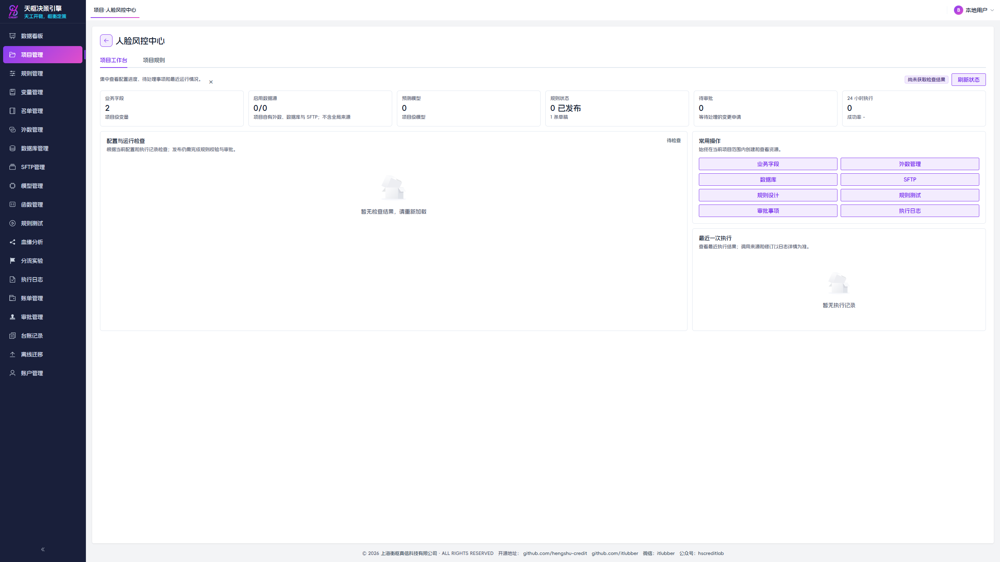](docs/project-usage/project-usage-07-project-detail.png) | [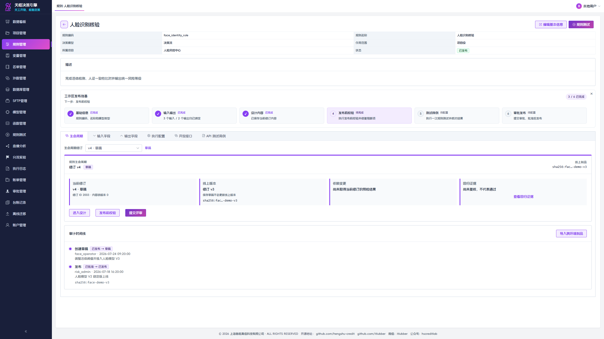](docs/project-usage/project-usage-08-rule-detail.png) |
| 查看人脸核验项目及其规则 | 核对输入、输出和当前版本 |

### 把供应商结果变成规则能用的数据

供应商返回的活体分和人脸相似度，可以分别对应到两个业务字段。配置一次，决策表、评分卡和其他规则便可引用同一口径。上线前可单独测试取数，确认返回值和字段对应无误，再测试整条规则。

| **外数接口** | **变量管理** |
| :--- | :--- |
| [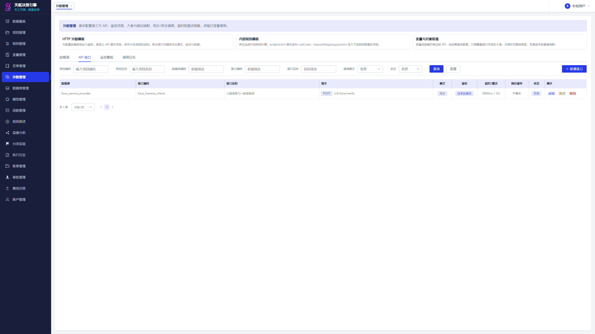](docs/project-usage/project-usage-10-api-list.png) | [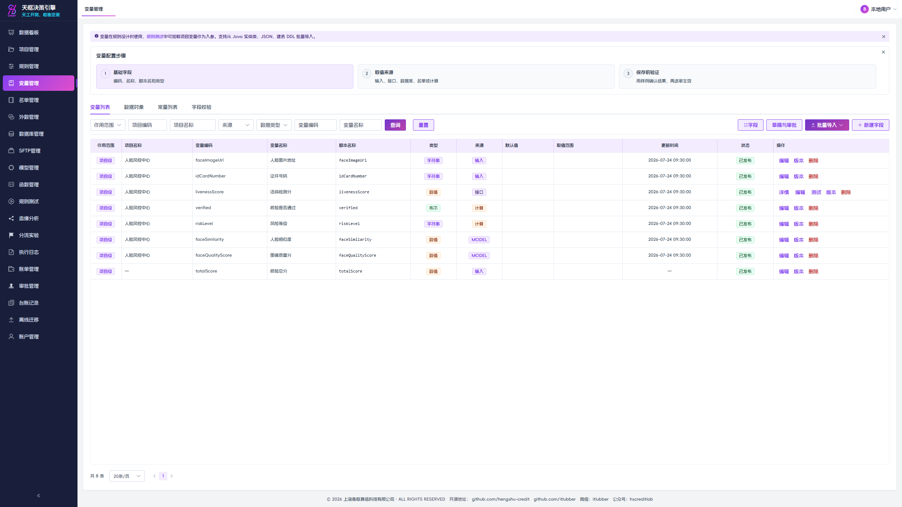](docs/project-usage/project-usage-03-variable.png) |
| 按供应商找到核验服务 | 查看规则可用的业务字段 |

更多数据来源与可复用的计算

数据对象把一组相关字段放在一起，例如一份申请中的客户资料。名单可按记录匹配准入或风险标签。内部业务数据可通过只读数据库查询，合作方提供的文件可通过 SFTP 查询。模型可以先独立试算，再把输出用于策略判断。多条规则共用的计算公式可保存为函数。

| **数据对象** | **名单管理** |
| :--- | :--- |
| [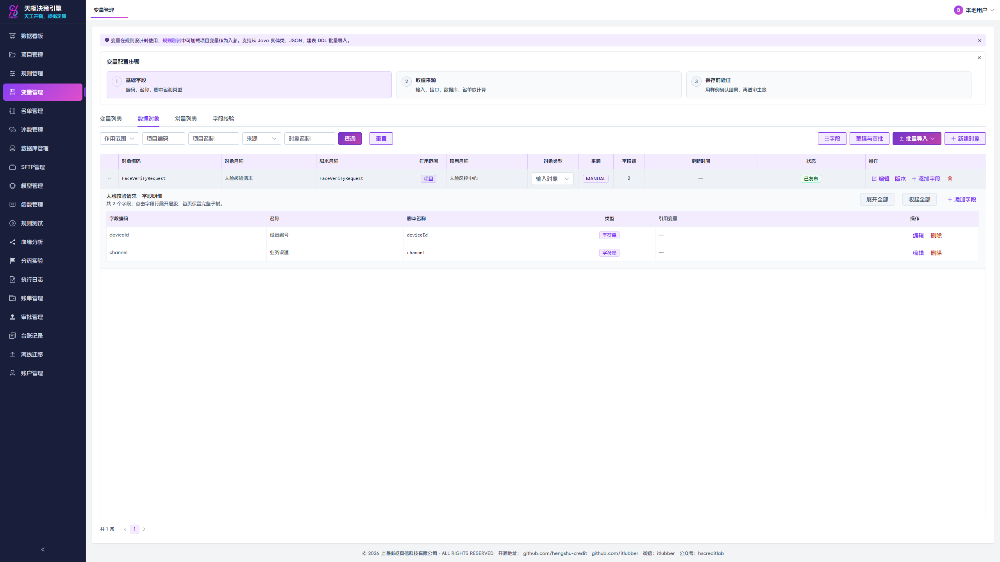](docs/project-usage/project-usage-03-data-object.png) | [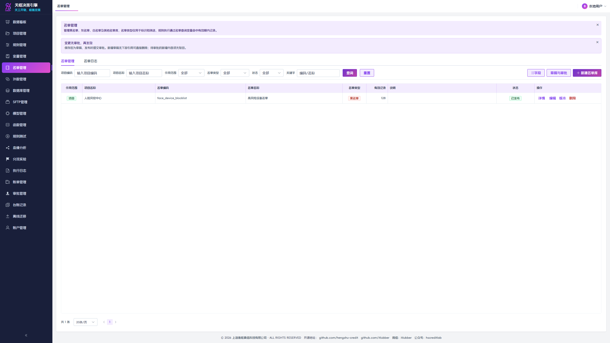](docs/project-usage/project-usage-09-list.png) |
| 按层级组织字段 | 查看项目下的名单库 |

| **模型管理** | **函数管理** |
| :--- | :--- |
| [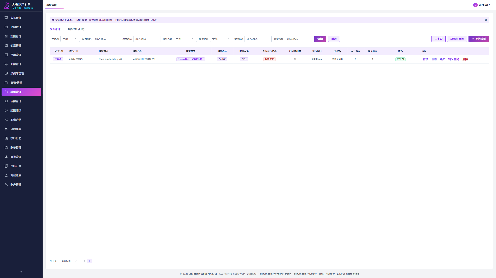](docs/project-usage/project-usage-13-model.png) | [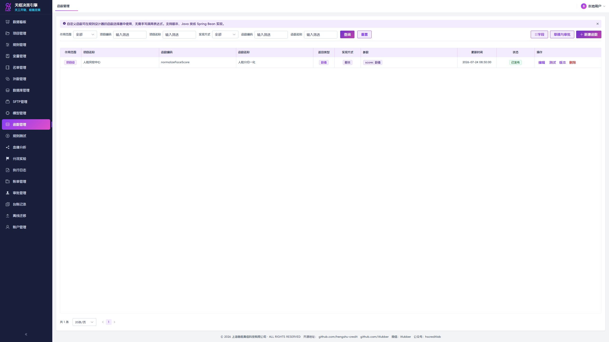](docs/project-usage/project-usage-04-function.png) |
| 查找项目使用的模型 | 在多条规则中复用同一公式 |

### 用样例验证，再审批发布

在人脸核验决策表中，一行就能写清通过条件。示例要求活体分至少 **0.95**、相似度至少 **0.90**。输入 **0.98** 和 **0.936**，测试结果为“核验通过、低风险”。点开测试追踪，可以对照每个条件的实际取值，看出结果来自哪一行。

| **决策表设计** | **决策表测试追踪** |
| :--- | :--- |
| [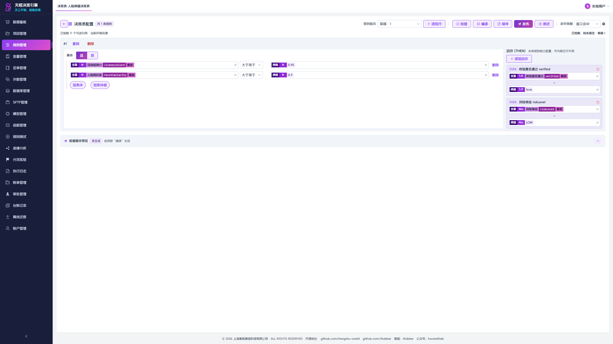](docs/project-usage/project-usage-designer-table.png) | [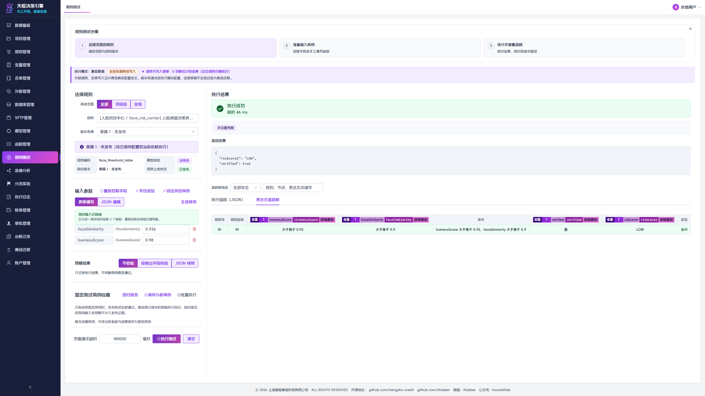](docs/project-usage/project-usage-rule-table-trace.png) |
| 同一行配置两个门槛和通过后的动作 | 核对实际命中行和输出 |

调整门槛后，可以用已收藏的正常、临界和异常样例一起复测。保存草稿后，线上继续使用已发布版本。提交审批时可核对依赖和改动。发布前，已启用的固定用例须全部通过。发布记录保留版本，后续可对比差异或回滚。

查看发布前检查与已发布版本

| **发布前检查** | **发布记录** |
| :--- | :--- |
| [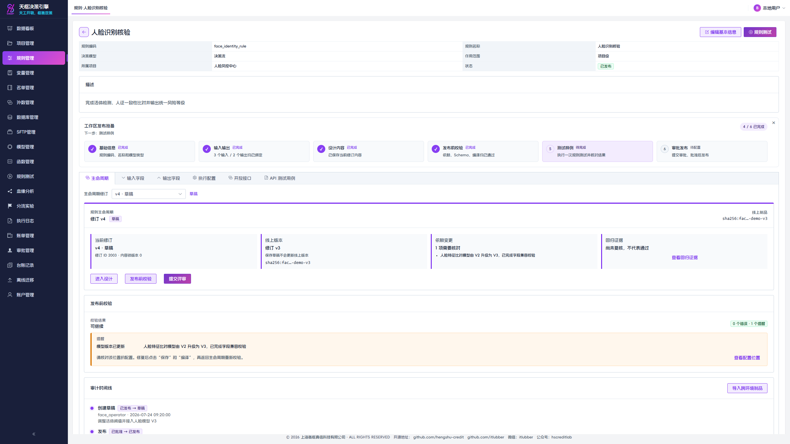](docs/project-usage/project-usage-08-rule-release-preflight.png) | [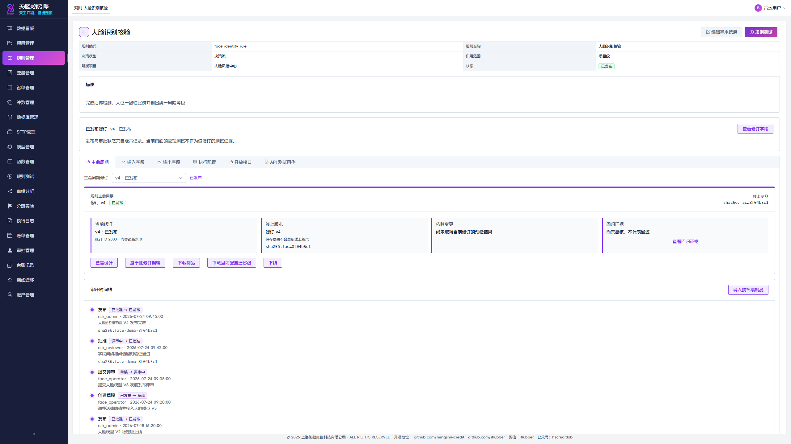](docs/project-usage/project-usage-08-rule-release-published.png) |
| 核对依赖和检查结果 | 确认已生效的规则版本 |

### 回看线上决策的结果、时间与费用

看板按项目、规则和时段汇总进件量、通过率、人审率及地区分布。“通过”“人审”“拒绝”可关联项目实际使用的结果值。若某天人审率升高，可先缩小到对应规则与时段，再从执行日志打开一笔申请，核对当时的输入、规则版本和执行路径。

| **数据看板** | **执行日志** |
| :--- | :--- |
| [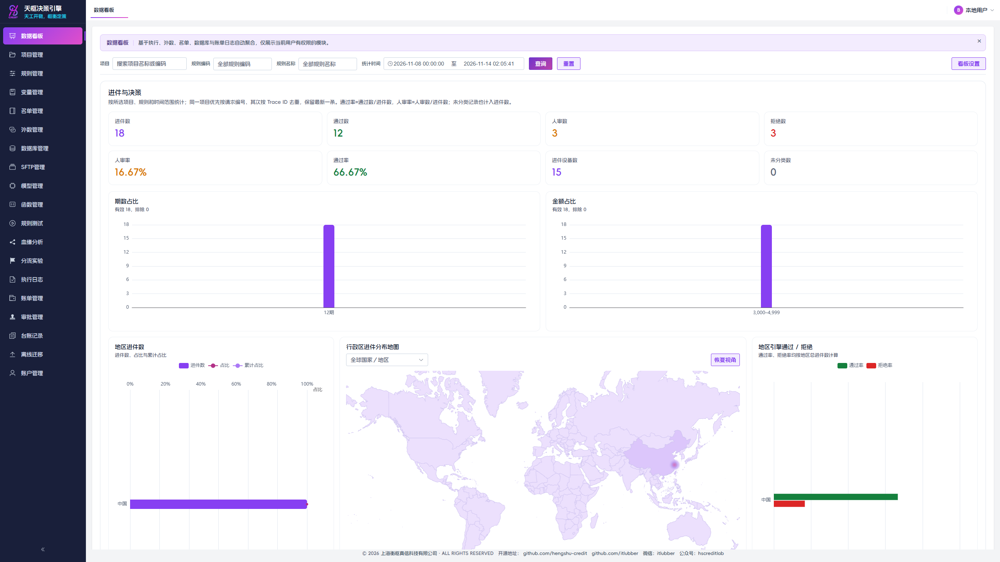](docs/project-usage/project-usage-18-dashboard.png) | [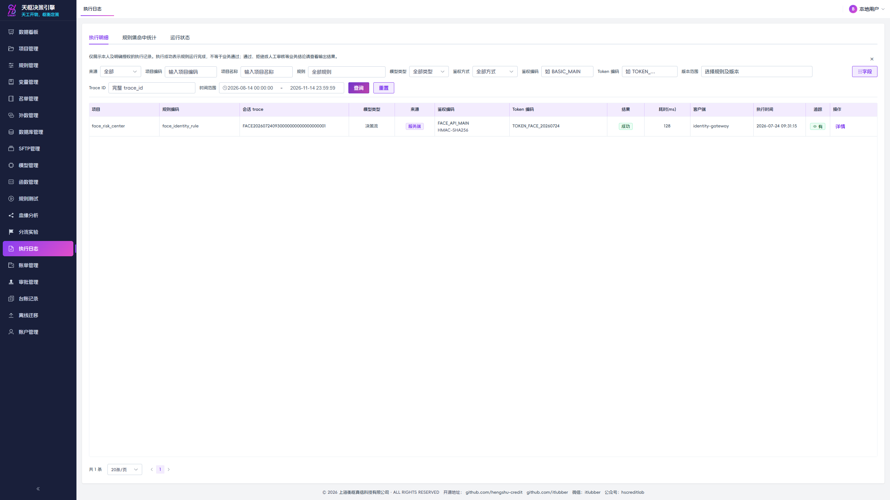](docs/project-usage/project-usage-06-execution-log.png) |
| 按时段观察进件与决策分布 | 找到同一时段的单笔执行记录 |

排查慢请求时，平均耗时反映整体水平，P95 耗时表示约 95% 的执行在这个时间内完成。遇到耗时较长的申请，可结合外数调用追踪核对供应商请求、重试和返回结果。

同一条规则反复执行时，引擎可以复用已编译的规则。外数结果若允许在一段时间内复用，也可以设置有效期，减少向供应商重复查询。账单按计费项汇总引擎执行和外部调用费用，并保留明细供核对。

查看外数调用追踪与账单

| **外数调用追踪** | **账单管理** |
| :--- | :--- |
| [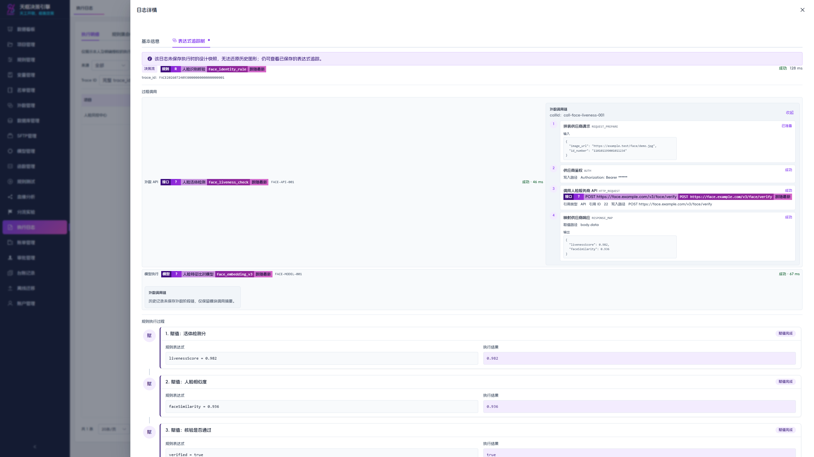](docs/project-usage/project-usage-10-external-call-trace.png) | [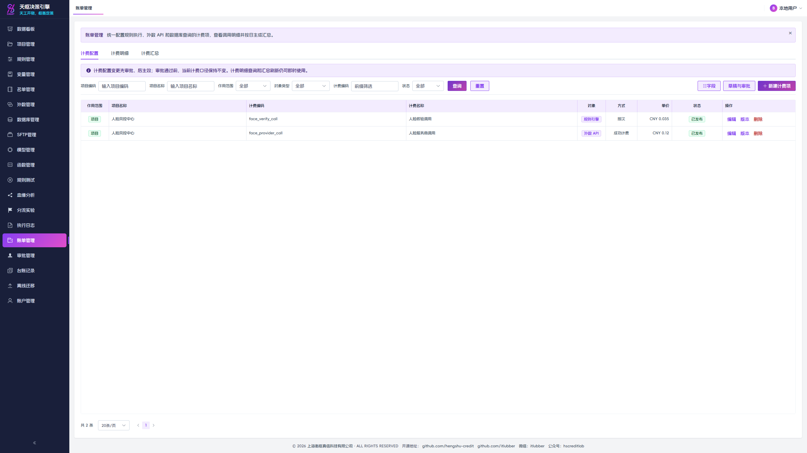](docs/project-usage/project-usage-16-billing.png) |
| 从供应商返回值追到业务字段 | 按计费项核对调用费用 |

### 比较新旧策略，再决定是否推广

调整核验门槛前，血缘图可以从一个字段或模型找到引用它的规则。分流实验可按条件或流量把申请分给现行策略与候选策略，也可让测试组试跑。复盘单笔实验时，可以看到分组原因、实际命中的组，以及该组规则给出的结果。

| **血缘分析** | **实验追踪** |
| :--- | :--- |
| [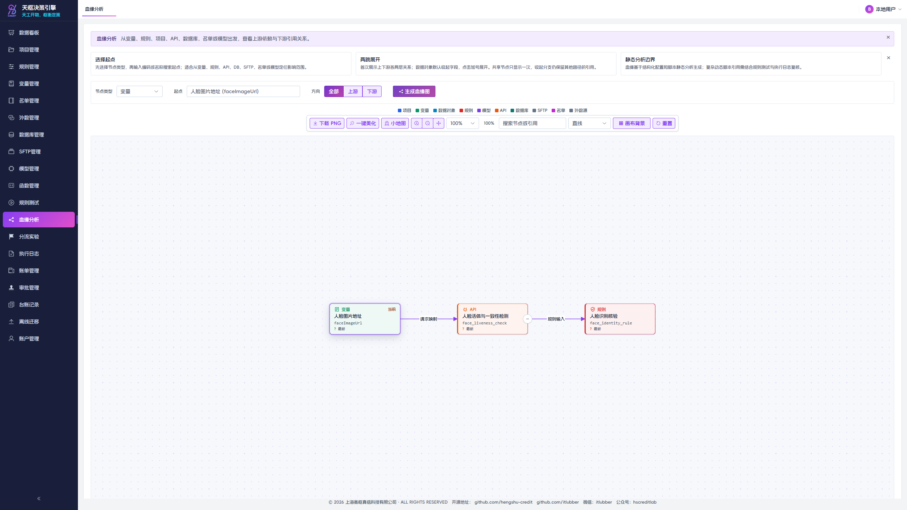](docs/project-usage/project-usage-14-lineage.png) | [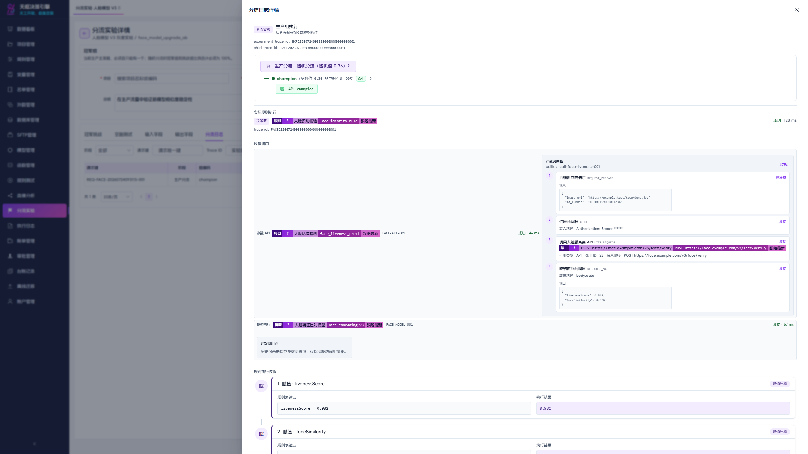](docs/project-usage/project-usage-15-experiment-trace.png) |
| 查看资源之间的上下游关系 | 沿命中组查看实际执行的规则 |

团队可将调高门槛的原因、实验结论和上线时间记入台账。跨环境交付时，离线迁移可连同依赖一起导出规则配置，在目标环境先检查冲突。项目负责人、审核人和运营人员按各自权限查看记录、处理变更。

查看审批记录与跨环境迁移

| 审批管理 | 离线迁移 |
| :--- | :--- |
| [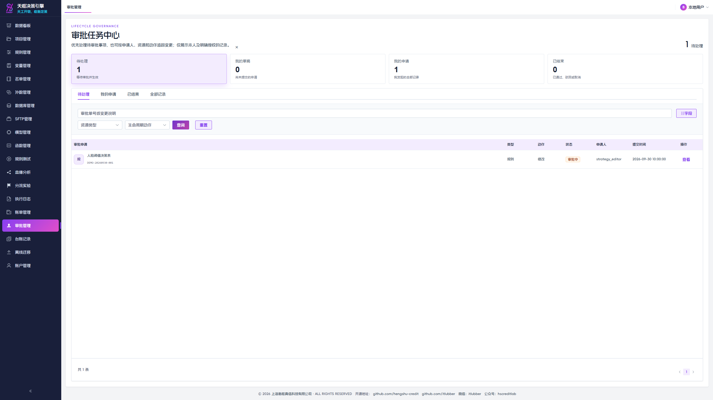](docs/project-usage/project-usage-21-approval.png) | [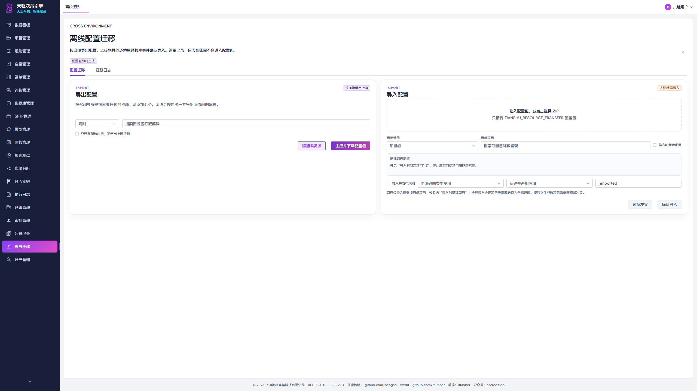](docs/project-usage/project-usage-22-transfer.png) |
| 核对待审批的变更 | 导出配置，在目标环境预检后导入 |

## 九类规则配置与测试追踪

同一项业务可以有不同的表达方式。例如，核验人员核对两项门槛时，决策表便于逐行检查。讨论“何时转人审”时，决策树更容易看清分支。需要解释一个风险等级时，评分卡可以列出各项分数。表中的配置与追踪对应同一类规则，可以对照查看设计和执行结果。

| 规则类型 | 适合表达的判断 | 示例配置与结果 |
| --- | --- | --- |
| 决策表 | 按行列出条件与动作，适合逐项核对准入门槛。 | [配置](docs/project-usage/project-usage-designer-table.png) · [命中行](docs/project-usage/project-usage-rule-table-trace.png) |
| 决策树 | 逐层判断，让通过和转人审走向不同分支。 | [配置](docs/project-usage/project-usage-designer-tree.png) · [判断路径](docs/project-usage/project-usage-rule-tree-trace.png) |
| 决策流 | 编排多个判断和动作，不同分支可以汇入同一个后续步骤。 | [配置](docs/project-usage/project-usage-designer-flow.png) · [执行节点](docs/project-usage/project-usage-rule-flow-trace.png) |
| 规则集 | 按优先级评估多条检查项，可取首次命中或收集全部命中。 | [配置](docs/project-usage/project-usage-designer-ruleset.png) · [命中清单](docs/project-usage/project-usage-rule-ruleset-trace.png) |
| 交叉表 | 用两个取值定位一个结果，例如用活体分和风险等级查出是否通过。 | [配置](docs/project-usage/project-usage-designer-cross.png) · [命中单元格](docs/project-usage/project-usage-rule-cross-trace.png) |
| 复杂交叉表 | 先划分区间或类别，再按多个维度组合查表。 | [配置](docs/project-usage/project-usage-designer-cross-adv.png) · [分段与结果](docs/project-usage/project-usage-rule-cross-adv-trace.png) |
| 评分卡 | 把命中项按权重计入总分。示例中，活体分达标计入 60 分。 | [配置](docs/project-usage/project-usage-designer-score.png) · [评分明细](docs/project-usage/project-usage-rule-score-trace.png) |
| 复杂评分卡 | 分别为多个维度评分，再把总分映射到等级。示例中，100 分对应低风险。 | [配置](docs/project-usage/project-usage-designer-score-adv.png) · [得分与等级](docs/project-usage/project-usage-rule-score-adv-trace.png) |
| QL 脚本 | 用自定义表达式处理特殊判断，可逐步查看参与计算的值。 | [配置](docs/project-usage/project-usage-designer-script.png) · [表达式追踪](docs/project-usage/project-usage-rule-script-trace.png) |

| 决策树 · 核验在哪一步转人审 | 复杂评分卡 · 风险等级如何得出 |
| :--- | :--- |
|  | [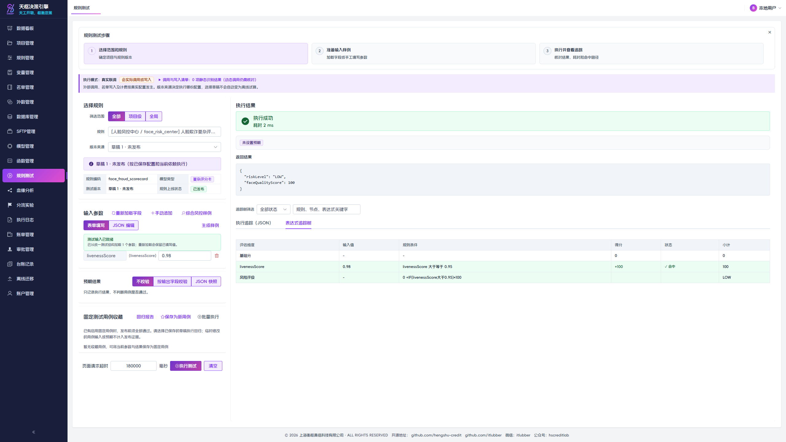](docs/project-usage/project-usage-rule-score-adv-trace.png) |

## 主题与工作台

多页签工作台可以同时打开规则、测试和日志，方便对照策略与执行结果。账户菜单中的“主题设置”支持明暗模式、色弱模式、纯色或渐变配色，以及顶部或左侧导航。查看较长的记录列表时，可选择在表格内滚动，让表头和分页保持可见。[主题预设](docs/project-usage/project-usage-19-theme-presets.png) · [自定义渐变](docs/project-usage/project-usage-19-theme-custom.png)

| **夜间主题** | **顶部导航** |
| :--- | :--- |
| [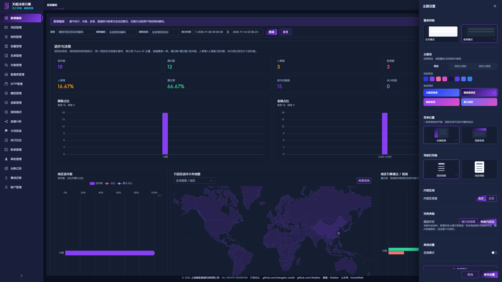](docs/project-usage/project-usage-19-theme-dark.png) | [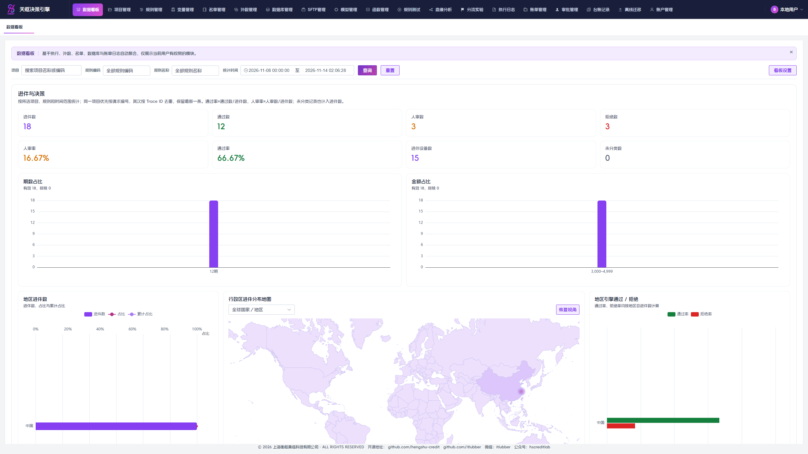](docs/project-usage/project-usage-19-theme-top.png) |
| 在深色界面预览配色 | 从顶部菜单切换业务模块 |

## 部署与系统接入

控制台与决策服务独立部署。策略人员通过浏览器管理规则，业务系统按项目授权调用已发布版本。MySQL 保存配置、版本和执行记录，Redis 通知客户端同步变更。Java 客户端可在业务应用内缓存并执行适合本地计算的规则，依赖外部取数或模型推理的规则可交给服务端执行。

| 使用场景 | 入口 |
| --- | --- |
| 首次部署 | 使用 Docker Compose 部署控制台和服务端，按需部署独立执行服务。首次打开控制台时创建管理员。[部署步骤](docker/README.md) · [配置与账户恢复](docs/deployment.md) |
| 对接业务系统 | 从项目的“API”入口导出接口文档，获取请求样例。支持直接调用服务端接口或集成 Java SDK。[接口约定](docs/platform-api-contract.md) · [Java 接入示例](docs/java-service-integration.md) |
| 更新已有环境 | 构建发布包，备份并停止旧应用，按需执行适用的数据库迁移，再启动新版。沿用原有配置与数据卷。[发布包构建](docs/release-packaging.md) · [应用更新](docs/server-upload.md) · [数据库迁移](rule-engine-server/src/main/resources/sql/migrations/README.md) |
| 运行维护 | 客户端默认通过 HTTP 上报执行日志，可选 Kafka。品牌、通知邮箱和登录策略由管理员统一配置。[日志上报](docs/kafka-execution-logs.md) · [系统配置](docs/system-settings.md) |

## 许可证与相关项目

项目许可证见 [LICENSE](LICENSE)，第三方组件与交付要求见 [THIRD_PARTY_LICENSES.md](THIRD_PARTY_LICENSES.md)。包含 JPMML 的制品或网络服务按 AGPL-3.0 要求提供对应源代码、许可证和重建材料。

相关项目：[QLExpress](https://github.com/alibaba/QLExpress) · [qlexpress-rule](https://github.com/xiachongbu/qlexpress-rule)
