<p align="center">
  
</p>
<h1 align="center">天枢决策引擎</h1>
<p align="center">
  
  <a href="https://github.com/hengshu-credit/tianshu-decision-engine/actions/workflows/ci.yml"></a>
  <a href="LICENSE"></a>
</p>
<p align="center"><strong>面向风控策略团队的可视化规则配置、执行与追踪平台</strong></p>
<p align="center"><a href="https://rule.hengshucredit.com/">在线体验</a> · <a href="https://hengshu-credit.github.io/tianshu-decision-engine/">操作手册</a> · <a href="#功能展示">功能展示</a> · <a href="#部署与系统接入">部署与接入</a></p>

一笔申请被转入人工复核，策略人员需要知道是哪项条件触发了分支，接入方需要核对引擎当时收到的数据。天枢把规则版本、输入输出和表达式追踪树关联起来，双方可以沿同一笔执行记录复核判断依据。

项目处于**未发布阶段**。在线体验账户为 `demo`，密码为 `hengshucredit`。自建环境首次访问时自行注册管理员。

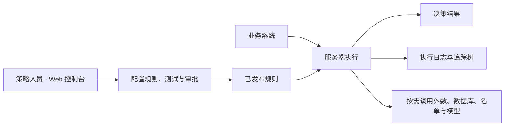

## 为什么选天枢？

同一条核验政策，策略人员可以用决策表规定通过条件，用评分卡输出连续分数，也可以让两版策略在分流实验中并行观察。上线前用固定用例验证边界，上线后在执行日志中找到当时的版本、命中条件和调用成本。

## 功能展示

下面以人脸核验为例。每组左图是配置，右图是同一示例的执行依据。点击预览图可查看完整界面。

### 决策表 · 人脸阈值决策表

每行配置一组条件及对应动作，本例采用首次命中策略。活体检测分为 0.98、人脸相似度为 0.936 时，追踪树标出命中行，两项输出分别为 `verified=true`、`riskLevel=LOW`。

| 决策表配置 | 决策表表达式追踪树 |
| :---: | :---: |
| [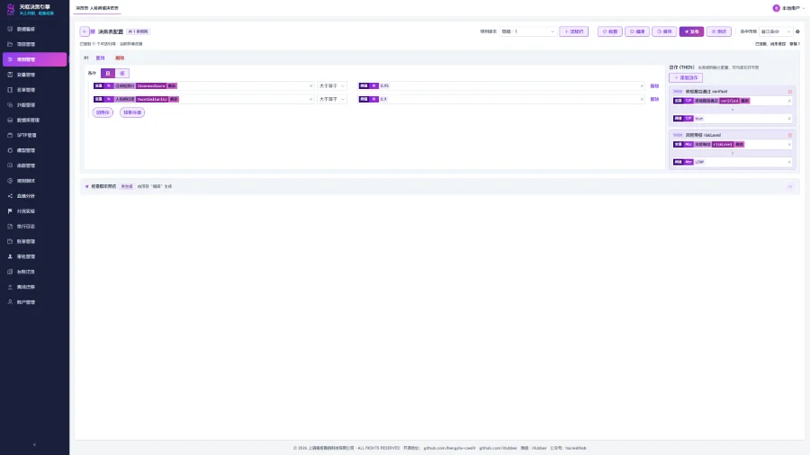](docs/project-usage/project-usage-designer-table.png) | [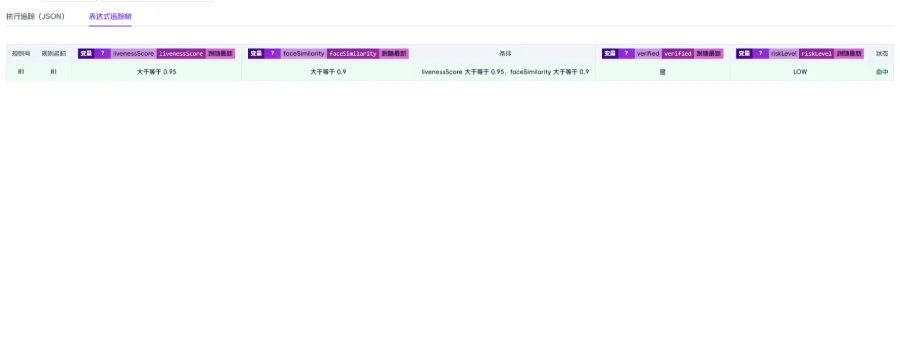](docs/project-usage/project-usage-rule-table-trace.png) |

### 决策树 · 人脸复核决策树

核验分数同时达标时走通过分支，任一项偏低时转人工复核。沿着本次高亮的分支，可以从根节点读到“核验通过 · 低风险”。

| 决策树配置 | 决策树表达式追踪树 |
| :---: | :---: |
| [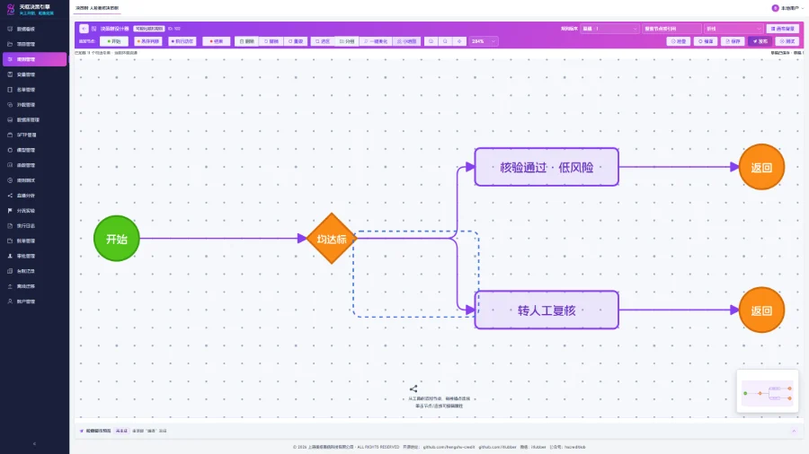](docs/project-usage/project-usage-designer-tree.png) | [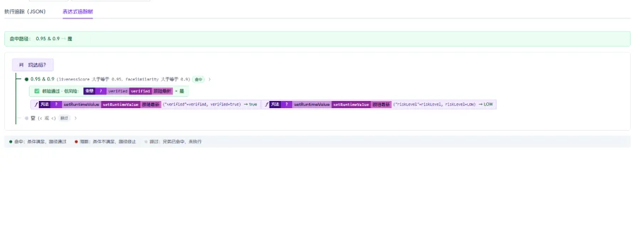](docs/project-usage/project-usage-rule-tree-trace.png) |

### 决策流 · 人脸识别决策流

通过和人工复核两个分支各自写入结果，再汇合到结束节点。对照执行路径，可以核实这笔请求经过了哪个任务、写入了什么值。

| 决策流配置 | 决策流表达式追踪树 |
| :---: | :---: |
| [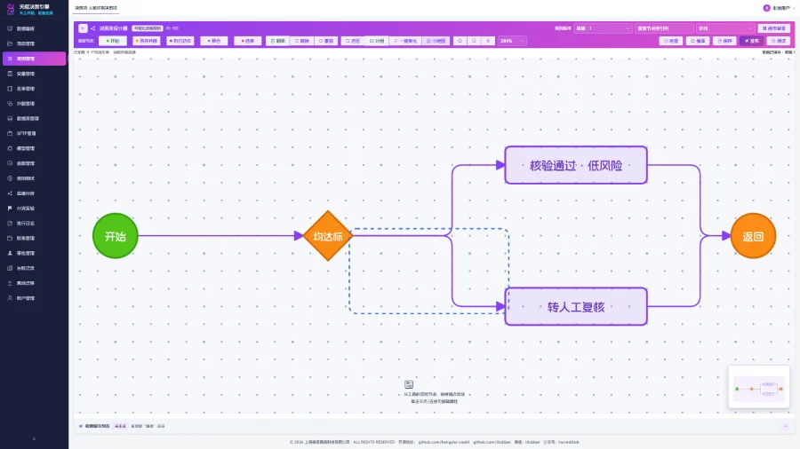](docs/project-usage/project-usage-designer-flow.png) | [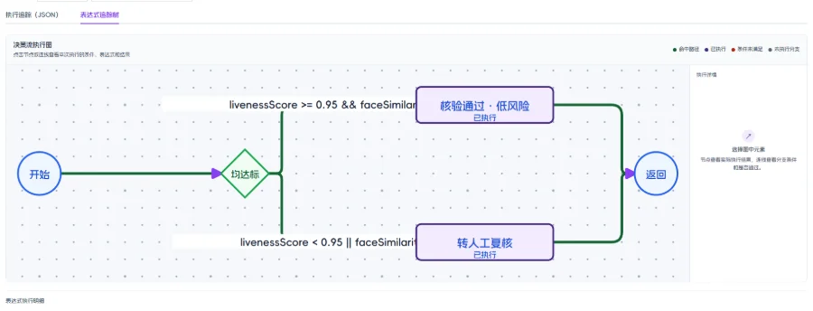](docs/project-usage/project-usage-rule-flow-trace.png) |

### 规则集 · 人脸风险规则集

给检查项设置优先级，再从命中清单核对实际执行顺序。本例命中“活体检测通过”，规则编码为 `FACE_LIVENESS_PASS`，优先级为 10。

| 规则集配置 | 规则集表达式追踪树 |
| :---: | :---: |
| [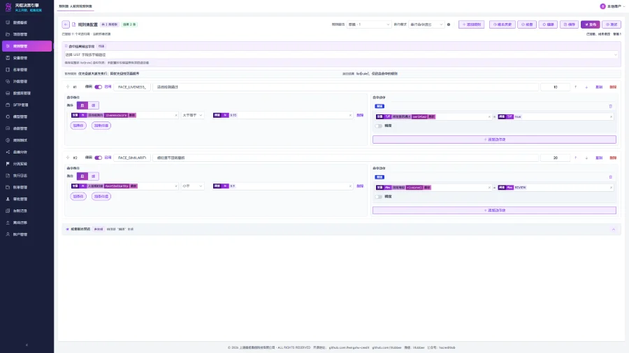](docs/project-usage/project-usage-designer-ruleset.png) | [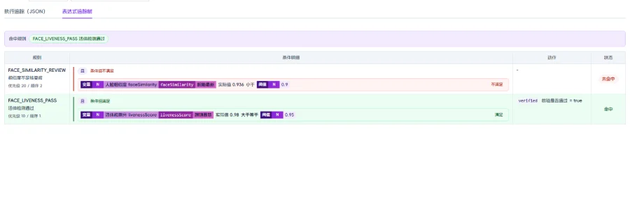](docs/project-usage/project-usage-rule-ruleset-trace.png) |

### 交叉表 · 渠道风险交叉表

用活体检测分选行、风险等级选列。输入 0.95 和 `LOW` 时，追踪树定位到返回 `verified=true` 的单元格。

| 交叉表配置 | 交叉表表达式追踪树 |
| :---: | :---: |
| [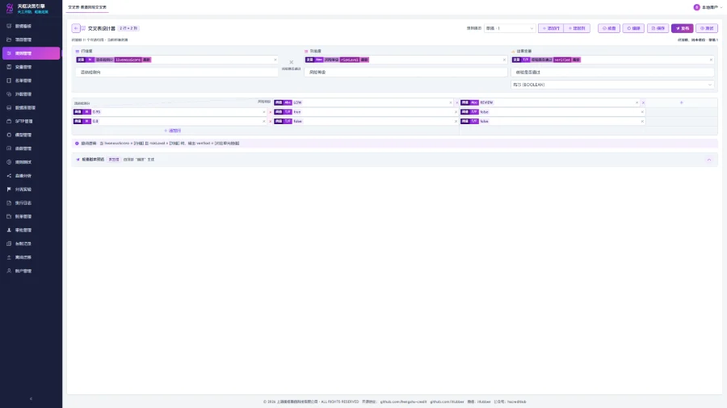](docs/project-usage/project-usage-designer-cross.png) | [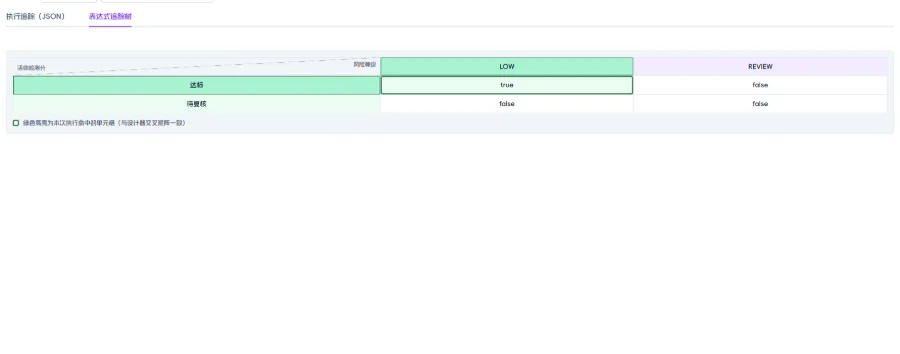](docs/project-usage/project-usage-rule-cross-trace.png) |

### 复杂交叉表 · 设备风险复杂交叉表

为行列维度设置分段条件。活体检测分 0.98、风险等级 `LOW` 落入哪两个分段、交点为什么返回通过，都可以在矩阵中核对。

| 复杂交叉表配置 | 复杂交叉表表达式追踪树 |
| :---: | :---: |
| [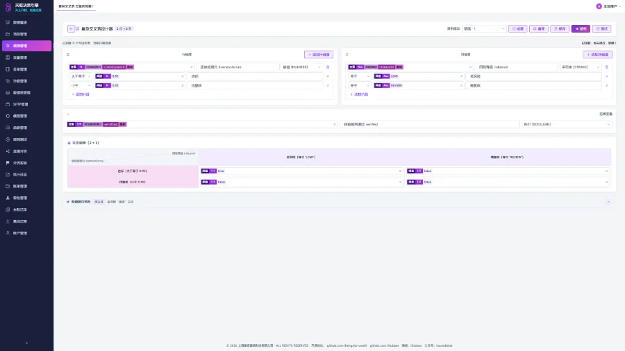](docs/project-usage/project-usage-designer-cross-adv.png) | [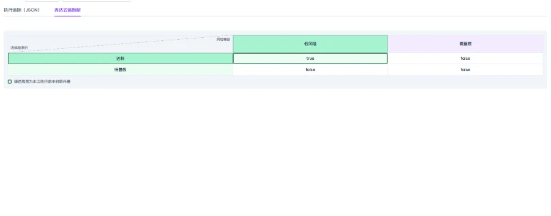](docs/project-usage/project-usage-rule-cross-adv-trace.png) |

### 评分卡 · 人脸质量评分卡

按活体检测分命中的评分项计算核验总分。输入 0.98 时输出 `totalScore=60`，追踪明细展示基础分和评分项。

| 评分卡配置 | 评分卡表达式追踪树 |
| :---: | :---: |
| [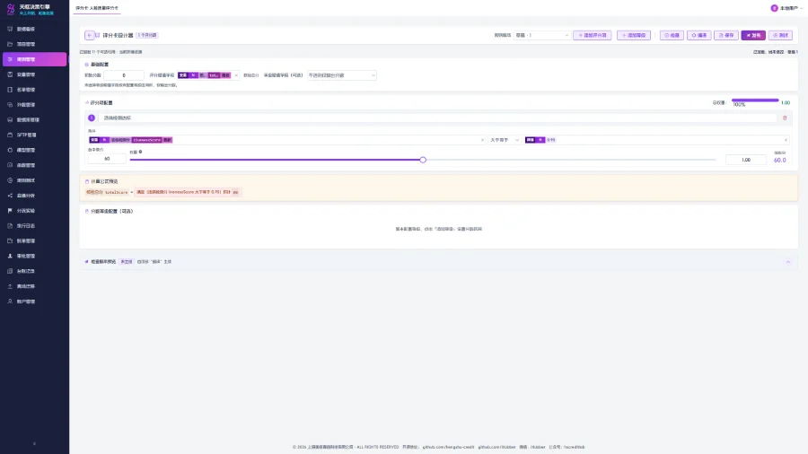](docs/project-usage/project-usage-designer-score.png) | [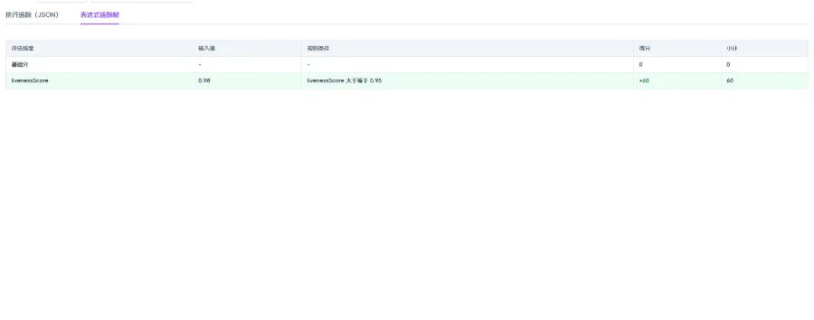](docs/project-usage/project-usage-rule-score-trace.png) |

### 复杂评分卡 · 人脸欺诈复杂评分卡

把指标按维度分组，先计算质量分，再按总分区间映射等级。本例得到 `faceQualityScore=100`，对应 `riskLevel=LOW`。

| 复杂评分卡配置 | 复杂评分卡表达式追踪树 |
| :---: | :---: |
| [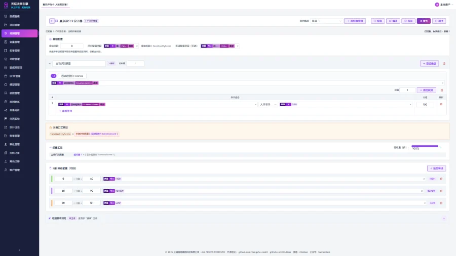](docs/project-usage/project-usage-designer-score-adv.png) | [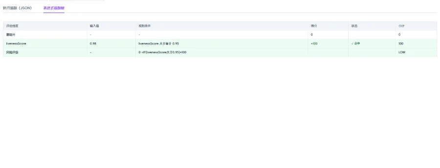](docs/project-usage/project-usage-rule-score-adv-trace.png) |

### QL 脚本 · 人脸兜底脚本

在 QLExpress 中直接写条件、赋值和返回值。脚本将活体检测分与 0.95、人脸相似度与 0.90 比较，追踪树展示此次进入的分支及其返回结果。

| QL 脚本配置 | QL 脚本表达式追踪树 |
| :---: | :---: |
| [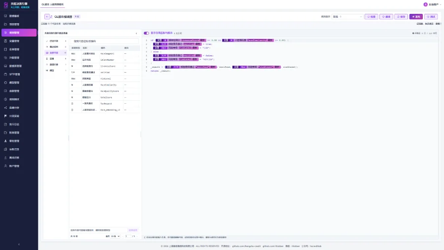](docs/project-usage/project-usage-designer-script.png) | [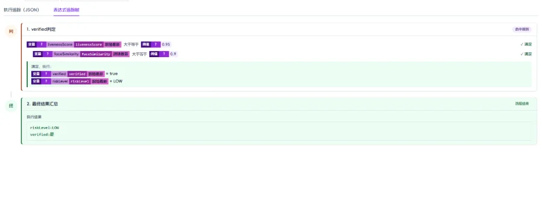](docs/project-usage/project-usage-rule-script-trace.png) |

### 外数 API · 人脸活体与一致性检测

在“请求字段”把业务变量绑定到供应商的 `image_url` 和 `id_number`。在同一接口的“接口测试”运行样例后，沿“完整外数调用链”核对请求拼装、供应商鉴权、HTTP 调用和响应映射，最终得到活体检测分 0.982、人脸相似度 0.936。

| API 配置 · 请求字段 | API 追踪树 · 完整外数调用链 |
| :---: | :---: |
| [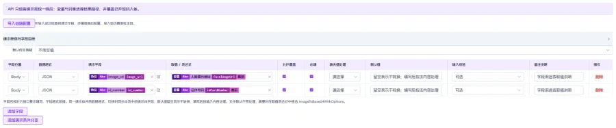](docs/project-usage/project-usage-10-api-config.png) | [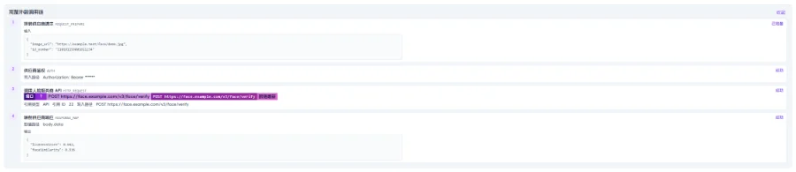](docs/project-usage/project-usage-10-api-execution-trace.png) |

### 分流实验 · 冠军组与挑战组

为同一实验配置生产组及流量比例，再打开分流日志。示例的随机值 0.36 落入占比 90% 的冠军组“V2 稳定策略”。展开下层规则追踪，可以继续核对该组为何返回 `verified=true`、`riskLevel=LOW`。

| 分流实验配置 | 分流追踪树 · 命中组与子规则 |
| :---: | :---: |
| [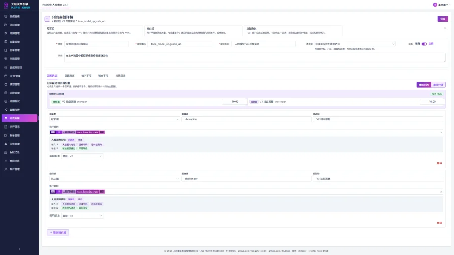](docs/project-usage/project-usage-15-experiment-config.png) | [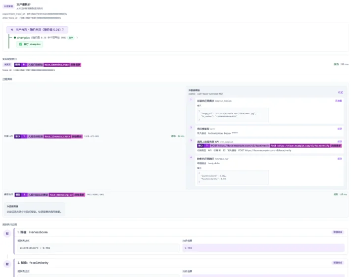](docs/project-usage/project-usage-15-experiment-trace.png) |

九类规则的输出与表达式追踪来自本地核心引擎执行。API 和分流使用固定文档样例，分别展示同一接口和同一实验的配置与追踪。[截图与样例生成方法](scripts/docs/README.md)

## 核心功能

| 业务任务 | 在天枢中怎样完成 |
| --- | --- |
| 编写准入和评分策略 | 在九类设计器中组合条件、矩阵、评分项或脚本，通过表达式追踪树查看每种规则的判断过程。 |
| 准备决策数据 | 从业务请求、外数 API、数据库、SFTP 或名单取得输入，复用变量、数据对象和函数，接入 PMML 或 ONNX 模型。 |
| 验证并发布版本 | 选择草稿或指定修订试算，保留固定用例，经依赖预检和审批发布。已启用的固定用例须全部通过。 |
| 比较两套策略 | 让冠军组和挑战组按条件或比例分配流量，测试组可空跑。按实验日志查看每次分组及其子规则。 |
| 复盘效果和成本 | 用看板观察决策分布，在日志中查单笔输出，用血缘图定位受影响的策略，并按账单明细核对外数和引擎费用。 |

## 快速体验

1. 登录[演示控制台](https://rule.hengshucredit.com/)，在“规则管理”打开一条规则，查看输入、输出和设计器中的条件。
2. 进入“规则测试”，选择同一项目、规则和待测版本，填写样例参数并执行。
3. 对照实际输出打开“表达式追踪树”。决策表按行展示命中情况，决策树按路径展示分支，评分卡列出得分项。可对照上方同类型的演示核对读图方法。

## 部署与系统接入

| 需要完成的工作 | 入口 |
| --- | --- |
| 本地开发 | 准备 JDK 17、Maven 3.6+、Node.js 20.19+、MySQL 8 和 Redis。服务端使用 `.env.server`，独立客户端使用 `.env.client`。[环境与参数](docs/deployment.md) |
| 部署或升级 | 首次部署选择完整单机或外部数据库模式。已有环境按发布包说明备份、迁移、更新和检查就绪状态。[Docker 部署](docker/README.md) · [构建发布包](docs/release-packaging.md) · [服务器更新](docs/server-upload.md) |
| 从业务系统调用 | HTTP 调用已发布的规则。Java SDK 也可在业务进程缓存并执行纯计算规则，涉及外数、历史统计或模型时使用服务端执行。[Java 接入](docs/java-service-integration.md) · [接口契约](docs/platform-api-contract.md) |

如果项目使用令牌鉴权，且已发布上例决策表，可用下面的请求核对结果。将 `ENGINE_URL` 设为自己的服务地址，`PROJECT_TOKEN` 设为获授该规则的项目令牌。

```bash
curl -X POST "$ENGINE_URL/api/rule/sync/execute/face_threshold_table" \
  -H "X-Rule-Token: $PROJECT_TOKEN" \
  -H 'Content-Type: application/json' \
  -d '{"clientAppName":"risk-service","traceEnabled":true,"params":{"livenessScore":0.98,"faceSimilarity":0.936}}'
```

## 交流与关注

维护方为上海衡枢真信科技有限公司。产品与部署咨询可发邮件至 [hscredit@hengshucredit.com](mailto:hscredit@hengshucredit.com)，或通过[官网联系页](https://hengshucredit.com/contact/)联系。

| 微信 · itlubber | 公众号 · 衡枢风控实验室 |
| :---: | :---: |
|  |  |
| 添加微信交流 | 关注后回复「入群」 |

## 文档与许可

完整的操作步骤、数据源配置、上线验收和恢复流程见[文档索引](docs/README.md)。项目采用 Apache License 2.0。对外提供包含 JPMML 的制品或网络服务时，还需按 AGPL-3.0 提供对应版本的完整源代码、许可证与重建材料。[项目许可证](LICENSE) · [第三方组件与交付要求](THIRD_PARTY_LICENSES.md)
