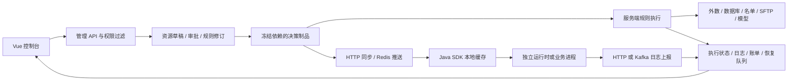

# 天枢决策引擎全模块研究与改进记录

日期：2026-10-27。依据：当前 `master` 工作区的代码、真实本地控制台、自动化测试和本次性能采样。本文独立建立问题清单，没有沿用历史优化计划的条目或完成状态。后续需求及排期见[新的优化计划与需求](../plans/2026-10-27-engine-optimization-requirements.md)。

研究后逐项修复的新增内容、逻辑复核及最新验证结果，见[实施与复核记录](2026-10-27-optimization-implementation.md)。本文保留首次研究时的问题及证据，不将历史验证数字当作最新统计。

## 1. 结论与覆盖方法

引擎已经具备从业务资源准备、九类规则设计、版本治理、测试发布到服务端/SDK 执行和追踪的完整骨架。主要改进方向是：保证配置编辑不改变业务语义，让跨模块流程可理解、可恢复，把真实依赖和副作用讲清楚，并用真实负载验证运行边界。

本次清单包含 19 个一级菜单、53 个路由定义项、57 个视图 Vue 文件及服务端 45 个 Controller 文件；同时检查公共模型、核心编译执行、SDK、独立运行时、数据库脚本、Compose、打包与质量门禁。53 项包含根路由、重定向和认证路由，并非 53 个独立业务页面。具体路径见[页面与接口入口索引](2026-10-27-engine-surface-index.md)。

覆盖采用四种证据：

- **代码确认**：目录与路由全量盘点，按模块追踪入口、请求契约、服务、持久化及共用组件；精读与问题相关的实现和测试。
- **真实 UI**：登录本地系统、访问所有一级模块、查看九类设计器，操作本次修改涉及的编辑、取消、字段设置和规则测试流程。
- **自动验证**：前后端基线、缺陷复现测试、修复后测试、生产构建、ESLint、Playwright 和部署质量脚本。
- **性能采样**：运行现有独立外数解析基准与运行上下文 JFR 脚本。采样环境、工作负载和适用边界单列，不能将微基准换算成生产 QPS。

远程供应商、真实 SFTP、真实外部数据库、异地恢复、多节点故障和真实业务容量，属于部署验收范围。当前本地数据库中的样例数量、历史配置和界面状态仅代表本次环境。

## 2. 产品定位与使用角色

平台面向可复用、可审查、可追溯的业务决策。业务配置员需要完成条件、阈值、分段、输出和测试；数据接入人员负责地址、协议、凭据、响应结构和运行参数；审核人员确认业务变更及依赖影响；运维人员负责部署、容量、日志持久化和恢复。一个账号可兼任多个角色，界面仍应说明每一步的目的。

保留已确认的产品约束：一级菜单平铺；SQL 可直接配置；引用以 ID 和 `ref_type` 为准；用户提供的编码、字段名和内容原样保存；发布和权限保护继续生效。业务人员具备 SQL 能力不等于熟悉 JDBC、连接池、异步回调或模型运行时，需要针对这些操作提供可选说明和默认值依据。

## 3. 当前架构与实际执行链路

| 层 | 实际职责与关键入口 | 评审判断 |
|---|---|---|
| `rule-engine-model` | 实体、DTO、平台结果码、HTTP 映射和执行契约 | 共享契约已存在；新增状态和字段应继续通过统一契约传播 |
| `rule-engine-core` | 九类 Compiler、Operand、VarContext、QLExpress、RequestContext、PMML | 已有 ID 绑定、常量保护、预编译缓存和追踪；本次修正 UNIQUE 动作执行顺序 |
| `rule-engine-server` | 控制台、治理、制品、依赖解析、鉴权、执行恢复、日志和计费 | 能力丰富；大服务类和跨模块状态传播是后续维护重点 |
| `rule-engine-client-sdk` | L1 缓存、HTTP 同步、Redis 订阅、冻结函数、本地/服务端执行、日志批量上报 | 已有版本与能力门禁；本地执行不等于所有来源均可脱离服务端运行 |
| `rule-engine-runtime` | 将 SDK 包装成独立执行服务及就绪检查 | 需结合鉴权、Redis 一致性和同步状态验收 |
| `rule-engine-web` | 路由、权限、多页签、表单、九类设计器、统一选择器和追踪 | 已有相当多引导与校验，主要问题是少数入口没有遵守共用契约 |
| `docker` / `scripts` | 外部依赖模式、完整单机模式、Kafka、打包、容量与恢复脚本 | 已有脚本不等于已在目标部署完成演练；保留现有端口、卷及 HTTPS 边界 |

主 Maven reactor 是五个 Java 子模块。仓库其他历史目录不能直接作为当前运行能力或缺失功能的依据。当前 `pom.xml` 使用 QLExpress 4.1.3，说明文件中部分版本和测试数量已经滞后。

## 4. 全模块覆盖矩阵

下表中的“改进”包括已复现缺陷和产品需求建议；建议不表示该模块整体不可用。A 编号是本次已修复问题，R 编号对应新需求计划。

| 模块 / 使用场景 | 当前能力及主要证据 | 问题或改进方向 |
|---|---|---|
| 登录、注册、找回、超管恢复 | `consolelogin/*`，Login/Register/PasswordReset/AdminRecovery | 初始化及恢复已有专门流程；将部署健康检查和账号引导对齐，避免把服务故障解释成账号错误（R01） |
| 数据看板与设置 | `Dashboard*Service`、DashboardHome/Settings | 已有字段映射、范围与口径说明；本地 9 条进件均未分类，应提供映射完成度及样例校验入口（R02） |
| 项目、工作台、鉴权、API 文档 | ProjectWorkbenchService、ProjectDetail、ProjectAuthDialog、ApiDoc | 执行摘要按稳定项目 ID 修复（A07）；就绪检查继续区分配置存在、连接成功及真实调用成功（R03） |
| 变量 | VariableList、VariableSourceSelector、VariableSourceResolver | 八类来源已存在；枚举响应解包修复（A02）；字段创建、取值预览、审批及返回原配置的连续性需加强（R04） |
| 数据对象、常量、字段校验、导入 | RuleDataObjectController、RuleFieldValidationController、Operand/FieldPicker | 支持导入和稳定引用；应统一展示缺失、空值、默认值、类型转换和校验失败的业务含义（R05） |
| 衍生变量及历史聚合 | DerivedVariableEditor、DerivedVariableValidator/Service | 已有 ID 校验、循环依赖和历史记录约束；需要展示时间窗口、统计范围、可用历史字段及样例计算过程（R06） |
| 规则列表、详情、版本及制品 | RuleDetail、RuleRevisionService、RulePublishService、artifact/* | 已有冻结依赖、回归证据、版本对比及回滚；术语及不同发布状态的下一步操作仍可收敛（R07、R08） |
| 九类设计器 | `views/designer/*` 与 `core/compiler/*` | A01、A03、A09；还需条件覆盖、矩阵扩张提示和更明确的错误定位（R09—R12） |
| 名单库、记录、导入、匹配日志 | ListLibrary/Detail、RuleListService、AsyncListActionService | 已有匹配与动作持久化；业务配置应明确记录有效期、匹配关系与写入行为（R13） |
| 外数数据源、API、鉴权、编排、回调 | DatasourceDetail、ApiDetail、ApiExecutionEditor、ExternalApiInvokeService | 同步、异步、轮询、回调和异常策略均已存在；首次接入仍需掌握多层术语，建议模板和分步试运行（R14、R15） |
| 外部数据库及 SQL | DatabaseDetail/List、DBConnectPools、VariableSourceResolver | 已有凭据编辑、只读查询、参数引导和超时限制；保留直接 SQL，增加结构和取值结果的连续预览（R16） |
| SFTP 连接和文件日志 | SftpDatasourceList/QueryLog、SftpDatasourceController | A04—A06、A08；连接池参数、字节数、主机指纹的解释及文件验证还需完善（R17） |
| 模型 | ModelDetail/List、ModelArtifactValidator、PMMLModelExecutor、onnx/* | PMML/ONNX 校验、版本和运行状态已有实现；显式说明支持的 ONNX 任务、设备要求、预处理及字段精确匹配（R18） |
| 函数及表达式 | FunctionList、ExpressionEditorPage、FunctionParameterContract | 原生实现有高权限门禁；业务人员可使用已发布函数，开发人员维护实现；需要调用样例与参数错误定位（R19） |
| 规则测试、固定用例、批量及回归报告 | RuleTest、DesignerTestDialog、ApiScenarioPanel、BatchTestService | 已有表单/JSON、用例、版本证据和报告过期检查；真实依赖调用和副作用应在执行前更明确（R20、R21） |
| 血缘 | LineageGraph、RuleLineageService | 已支持上游/下游及共享节点；服务端先建立全图再裁剪，复杂动态脚本仍属静态分析边界（R22） |
| 分流实验 | ExperimentDetail、RuleExperimentService、执行状态服务 | 冠军挑战、测试组、比例、版本和空跑已存在；需要用样例直观解释分组、互斥及真实外数开关（R23） |
| 执行日志、模块调用日志、恢复监控 | ExecutionLog、ModuleCallLog、ExecutionMetricsPanel、执行状态/持久化服务 | 已有修订归因、逻辑日志、队列监控；应把“失败原因—对应配置—重试条件”连成可操作路径（R24、R25） |
| 计费配置、明细、汇总 | BillingList、BillingService、BillingSummaryTaskService | 审批与异步刷新已有实现；需要明确计费触发、重试去重和对账口径（R26） |
| 审批中心 | ApprovalList/Detail、GovernanceApprovalService | 提交、依赖复核、锁及状态流转已有实现；跨资源批次的顺序和失败恢复可改善（R27） |
| 离线迁移 | OfflineTransfer、transfer/*、TransferAssociationPanel | 配置包、冲突预检、ID 映射、版本选择已有实现；需要清晰说明配置包与决策制品的用途和凭据补配（R28） |
| 账户、角色、个人资料、审计 | AccountManagement/Profile、OperationLogs、security/* | 模块、项目、全局读写及会话失效控制已存在；增加最终权限来源解释与受限角色真实浏览器验收（R29） |
| 系统配置 | SystemSettings、system/*、WatermarkSettings | 品牌、邮件、安全、结果码和变更记录已有实现；配置影响范围和发布前验证需要统一（R30） |
| SDK、运行时及集成 | RuleEngineClient、HttpSyncClient、RedisSubscriber、RuntimeController | 已有预热、同步及服务器能力门禁；增加运行能力清单及同步滞后诊断（R31） |
| 部署、监控、恢复、许可证及文档 | Compose、schema、quality-gates、NOTICE/THIRD_PARTY_LICENSES | 需要目标环境容量、备份内容校验、灾备与源码交付验收（R32—R36） |

## 5. 九类设计器的业务复杂度

复杂度是基于当前界面和配置结构的定性判断，尚未经业务用户可用性实验测量。

| 类型 | 适合的任务 | 当前配置负担 | 后续验收重点 |
|---|---|---|---|
| 决策表 | 条件组合映射结果 | 中：条件树、操作数、动作与命中策略 | 唯一命中先判冲突；零/单/多条命中解释；重叠条件定位 |
| 决策树 | 层层判断的路径 | 中高：节点、分支、连线和动作 | 不可达节点、缺省分支、环、键盘定位、追踪对应节点 |
| 决策流 | 组合规则与业务动作 | 高：节点语义、子规则、聚合、异常与副作用 | 分支合并、重复调用、等待恢复、超时预算、动作幂等 |
| 规则集 | 多条独立策略集合 | 中：优先级、顺序、模式及命中输出 | 同优先级顺序、串行退出/全量命中的区别、大规则集脚本规模 |
| 交叉表 | 两个维度映射结果 | 中：行列、边界和默认值 | 新增/删除维度后结果归属；空单元格；未命中行为 |
| 评分卡 | 分项加权与等级 | 中：分数、权重、分段、等级 | 总分公式、边界、缺失值、重叠区间及等级空值 |
| 复杂交叉表 | 多维组合矩阵 | 高：维度笛卡尔积、分段与单元格对应 | 自动同步不能重建业务分段；扩张前提示单元格数量 |
| 复杂评分卡 | 分组评分与等级 | 高：组、维度、分段、权重、结果 | 分项贡献解释、类型校验、等级边界和字段版本 |
| QL 脚本 | 表达式难以可视化的特殊策略 | 高：需要脚本能力 | 保留开发人员入口；展示静态引用边界、错误行及测试证据 |

真实页面中，全局样例加载了 20,428 个可选引用，项目样例加载了 20,471 个。来源目录规模已足以影响选择效率；应针对首屏加载、搜索、已选引用回显和多页签内存分别建立基线。

## 6. 本次已复现并修复的问题

| 编号 | 级别 | 问题、复现证据 | 修复及兼容边界 |
|---|---|---|---|
| A01 | P1 | UNIQUE 决策表两条规则命中时，先调用两次动作函数再报错；新增测试原结果为 `expected 0 but was 2` | 两阶段执行：先按原条件统计命中，再执行唯一命中行的动作；每个条件仅求值一次；FIRST/ALL 语义保留；条件求值自身仍可能读取来源 |
| A02 | P1 | 枚举接口返回平台响应 `{data: [...]}`，mixin 当数组存储，取值时报 `opts.map is not a function`；变量和对象字段均复现 | 从 `data` 解包并兼容直接数组；值、标签和 ID 原样保留；覆盖两个接口 |
| A03 | P1 | 复杂交叉表自动刷新字段元信息，调用了面向“主动换字段”的逻辑，重建枚举分段；测试中“其余客户 != VIP”被替换成“重点 == VIP” | 自动同步只更新引用元信息；保留原分段、条件、顺序和单元格；主动选择枚举字段仍可初始化选项。结合 A02，真实页面恢复“已加载，尚未修改”，离开无误提醒 |
| A04 | P1 | SFTP 弹窗填写内容后直接取消，无未保存提醒；重新打开内容丢失 | 复用配置离开保护；取消、关闭按钮、Esc、页签关闭和刷新共享保护；确认放弃后清除组件中的配置和凭据 |
| A05 | P1 | SFTP 连续调用保存，校验等待期间可发出两次创建请求；保存时可关闭/替换表单 | 校验前进入保存状态，重复提交直接返回；保存中禁用表单和关闭；失败保留输入，成功才清理 |
| A06 | P2 | SFTP 编辑读取慢返回可覆盖刚打开的新建表单，测试原结果出现旧资源 ID | 编辑请求使用递增标识；新建、关闭、卸载使旧响应失效；旧错误也不能覆盖当前状态 |
| A07 | P1 | 项目工作台按 `projectCode` 查询执行摘要，无法正确处理历史编码与当前归属差异；独立 H2 用例包含其他项目同码和未知归属日志 | 最近次数、成功次数和最近执行均按 `executionProjectId` 查询；不通过编码猜测未知日志归属；大数据量部署需验证该字段查询索引 |
| A08 | P2 | SFTP 数据源和查询日志缺少公共字段设置入口 | 按项目列表已有模式使用声明式列顺序；字段按钮位于右侧操作区首位；隐藏、排序和浏览器偏好可保留，操作列固定可用 |
| A09 | P2 | 历史决策表未保存 hitPolicy 时界面显示“请选择”，编译器实际按 FIRST；UNIQUE 文案声称必须恰好一条，与零命中合法的实现不符 | 界面补齐相同默认值；文案说明“最多一条，未命中或冲突不执行动作”；显式配置保持原值 |

**生效范围**：A01 影响后续编译的脚本。已有发布制品不可变，需要正常重新编译、回归、审批和发布后才使用新的脚本；本次没有批量改写历史制品或自动发布业务规则。

真实浏览器验证使用合成输入，在未保存画布上复制一条条件：多条命中返回 UNIQUE 冲突；零命中执行成功且输出 `amount: null`；随后恢复单条命中验证。测试过程通过 UI 操作，原有规则草稿未被保存覆盖。

## 7. 未解决问题与下一轮优先级

| 优先级 | 发现与证据 | 需求处理 |
|---|---|---|
| P1 | `executeTest` 使用默认 VariableResolveOptions，绑定外数和名单写入能力；`dryRun` 默认为 false。界面“当前画布预览”主要解释版本，缺少统一的调用/写入清单 | R20：明确纯计算预览与真实依赖联调；复用 dryRun/offlineReplay 能力，涉及真实调用或名单写入时展示范围与结果，不以“测试”暗示无副作用 |
| P1 | 真实 UNIQUE 错误反馈仍包含英文内部函数名、源码片段和行列信息 | R10：中文原因、冲突行、影响及修复入口为主；保留技术详情供排障 |
| P1 | 多个弹窗仍没有配置页同等级的离开保护；SFTP 已修复，不能据此推断所有入口均已覆盖 | R04/R07：逐入口建立脏状态、保存中锁定和失败保留矩阵 |
| P1 | `varPickerMixin` 加载完整可见引用并批量加载枚举选项；真实目录超过两万项 | R11：按需目录、搜索与分页、版本身份缓存、权限失效；以实测响应和内存决定实现 |
| P1 | 普通/复杂交叉表按行列位置持有单元格，维度变化需要明确迁移语义；多维组合按笛卡尔积增长 | R12：变更前展示影响，按稳定维度身份重映射或显式清空，禁止静默错配；设置可解释规模限制 |
| P1 | `TableColumnSettings` 的 DOM 回退依赖根元素；部分入口未采用声明式列绑定，本次新增 SFTP 入口的浏览器测试曾揭示该问题 | R33：逐入口迁移到已在项目列表和 SFTP 使用的声明式模式；覆盖模型、数据库、外数、名单调用日志的刷新和持久化 |
| P1 | 工作台归属查询改用稳定 ID，而当前 schema 未声明针对 `execution_project_id` 的专用查询索引 | R03/R34：以 MySQL EXPLAIN 和百万日志数据验证最新记录/24 小时计数，设计幂等索引升级；不能用小样本 UI 代替容量验收 |
| P2 | 血缘图服务在 `graph()` 中先 `buildFullGraph()` 再遍历裁剪；界面初始两跳不代表后端只读取两跳 | R22：评估按邻接关系查询或权限隔离缓存；保留动态脚本分析边界 |
| P2 | 变量页约 6,113 行、追踪组件约 5,804 行、外数服务约 4,090 行 | R35：围绕真实修改热点分拆职责，契约测试先行，避免一次性重写 |
| P2 | SFTP、数据库、外数配置同时暴露多项协议/池/重试参数；当前已有文字引导，但尚无业务用户操作实验 | R14/R16/R17/R36：基础连接与可选参数分区、直接 SQL、默认值说明和五人任务验证 |
| P2 | `index`、看板、图编辑器 bundle 超过 Vite 500 kB 提示阈值 | R34：按路由与交互测量首屏、依赖预热和解析，按实际瓶颈拆包；不提高告警阈值掩盖问题 |

## 8. 执行效率与容量判断

已实现的效率措施包括：QLExpress 有界预编译缓存（1024）、请求内来源复用、可配置来源并行度、有界执行池、模型会话复用、SDK L1 缓存和异步日志批量上报。应在这些机制上验证和改进，避免再引入一套平行缓存或执行框架。

本机测量：

| 工作负载 | 结果 | 解释 |
|---|---|---|
| 8 个独立阻塞来源，每个模拟 30 ms；3 次预热、9 次采样 | 串行中位 251 ms / P95 280 ms；并行度 4 中位 62 ms / P95 77 ms | 中位改善 75.1%；只证明独立阻塞来源适合并行，不能推广到共享依赖、供应商限流或 CPU 密集模型 |
| 预编译简单布尔规则，已有 32 组常量的请求上下文 | 约 1,425.5 ns/次，1,360 bytes/次 | 固定工作负载微基准；未包含 HTTP、数据库、外数、持久化及多租户争用 |
| 相同预编译表达式，新的空 RequestContext | 约 396.2 ns/次，2,048 bytes/次 | 与上一行上下文工作量不同，不能当作本次改动的性能提升比例 |
| 32 组嵌套常量复制 | 约 6,857.3 ns/次，9,472 bytes/次 | JFR 采样主要落在 snapshotValue；常量隔离是正确性要求，优化不得移除保护 |
| 上下文快照/安装 | 约 1,633.2 ns/次，12,400 bytes/次 | 后续关注来源状态复制与上下文传播，先用真实模型和请求规模复测 |

并行度当前代码默认 1。修改默认值前必须验证同一供应商限流、数据库连接池、依赖顺序、共享请求、超时取消和拒绝策略。大矩阵、规则集生成脚本规模、长追踪和全量元数据是另一类容量问题，应单独测量。

## 9. 验证记录与复现方式

本次日志及截图位于仓库的 `.codex-validation/review-20261027/`；JFR 位于 `.codex-validation/runtime-cache/review-20261027-*`。这些目录是本地验证产物，不包含登录凭据。

| 验证 | 结果 |
|---|---|
| 修改前 `npm test` | 305 文件，3561 用例通过 |
| 修改前 `mvn test` | 2919 用例，67 跳过，0 失败/错误 |
| 新增缺陷复现 | UNIQUE 动作先执行、枚举响应、交叉表分段、SFTP 三类状态问题、工作台归属、历史命中默认值均先失败再修复 |
| `mvn clean install -DskipTests` | 五个子模块成功；未发现 deprecated API 或 unchecked/unsafe 编译告警 |
| `mvn spring-boot:run` | 独立端口 18080 启动；规则预热 38 个有效版本，0 拒绝；readiness 为 UP |
| 修复后 `mvn test` | 2923 用例，67 跳过，0 失败/错误；含内部临时变量与业务字段同名的补充回归 |
| `npm run dev` | 独立端口 19090，代理本次后端；真实浏览器验证，无前端控制台错误 |
| `npm run build` / `npm run lint` | 生产构建和 lint 通过；保留大 bundle 提示，未掩盖 |
| Playwright 定向回归 | 74/74 通过；九类设计器、引导流程、字段选择器、SFTP 宽窄布局及本次新增交互 |
| 部署质量工具测试 | 43/43 通过；属于脚本测试，不代表完成真实备份恢复或容量演练 |

重启验收中曾出现 MySQL `Communications link failure`，导致 ONNX 预热失败和 readiness=503；保留失败日志，停止本次验证节点后重新启动，最终 readiness=UP。该过程说明预热状态门禁确实工作，同时也暴露了瞬时依赖故障后需要更方便的预热重试入口，纳入 R18/R25。当前运行库未启用 CUDA Provider，部分配置按已有策略回退 CPU；本次不将这类运行时提示计作编译告警或 GPU 验收通过。

前端最终全量测试、服务清理及实机操作证据以[本次交付验证记录](2026-10-27-engine-verification.md)为准。跳过用例包含需要显式环境或资产的集成/诊断场景，不能写成“所有真实环境验证通过”。

## 10. 实施原则

后续先完成业务语义与操作保护，再做配置效率和容量优化。每项改动应具备业务场景、现状证据、最小实现、回归范围、验收条件及回退方式。已发布制品保持不可变；原生函数权限、凭据空白/替换/清除、会话失效、ID 引用和日志归属均作为跨模块回归门禁。
