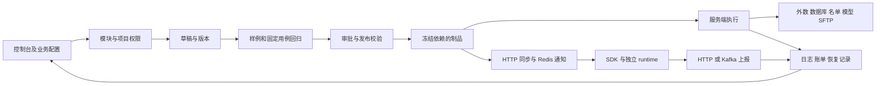

# 天枢决策引擎整体研究、修复与验收

日期：2026-11-05。基线：`master` 的 `70673373`。本轮直接在主分支工作，开始时工作区干净。

## 结论与证据范围

当前引擎已具备资源准备、九类设计器、版本治理、回归发布、服务端/SDK 执行、日志与账单的完整主链。主要问题集中在跨模块契约没有全部复用、编辑保护不一致、异步响应生命周期、真实 Spring 运行环境与测试夹具的差异，以及大规模配置的解释与性能预算。

本轮完成六个模块的结构盘点、20 个一级菜单的真实登录访问、主链代码与测试检查，修复下表中的具体缺陷。入口清单覆盖 **57 个路由定义、61 个视图组件、46 个 Controller 类**，见[代码入口索引](2026-11-05-engine-surface-index.md)。索引包含认证、运维和辅助入口；路由数量不是独立业务页面数量。

证据分为：当前代码确认、真实本地 UI、真实 dist 加模拟 API、单元/集成测试、独立微基准。全量入口盘点不等于逐行审计，也不等于全部角色、供应商、数据规模和灾备组合均已验收。上轮记录用于了解设计沿革，本文测试数字全部来自本轮执行。

## 产品需求与整体设计

| 角色 | 应能独立完成的工作 | 页面应提供的帮助 |
|---|---|---|
| 业务配置员 | 选择项目、准备字段、设置条件/评分/结果、测试与提交 | 业务术语、明确默认值、边界样例、错误定位、可恢复编辑 |
| 数据接入人员 | 配置 API、SQL、名单、SFTP、模型及取值映射 | 连接与业务查询分开验证，解释凭据、类型、超时、空结果与副作用 |
| 审核人员 | 查看差异、依赖、回归证据，批准/发布/回滚 | 当前设计版本与线上版本分离，旧证据失效原因和下一步入口 |
| 运维/集成人员 | 部署、凭据、同步、监控、容量、恢复 | 真实就绪状态、可执行检查、队列/丢弃指标、兼容边界 |

保留一级菜单平铺、直接 SQL 配置、ID 与 `ref_type` 关联、用户编码原样保存。非技术人员适配应改善引导和反馈，不应通过隐藏已有业务能力来简化页面。

四条核心业务流程应作为持续验收单元：首次创建策略；接入数据并返回规则；修改已发布策略并重新取得回归证据；从失败日志定位配置并判断是否可重试。单个页面能保存，不足以证明这些流程完整。

## 全模块审查矩阵

“现状”来自当前目录、入口、实现及测试；“后续重点”是尚未在本轮全部完成的需求，不能当成已修复清单。

| 范围 | 当前实现与判断 | 后续重点 |
|---|---|---|
| 登录/注册/恢复 | `consolelogin`、认证路由、单超管恢复和权限版本控制已存在；本轮用户登录本地验证 | 对部署连接失败、升级缺列、账号错误提供分别可操作的提示 |
| 看板 | 执行、外数、数据库、账单、审批聚合及映射设置已存在；真实页面提示部分映射失效 | 无数据、无权限和映射失效不能只呈现同样的 0；增加映射完成度与样例解释 |
| 项目与工作台 | 项目、鉴权、API 文档、配置就绪检查已有入口 | 就绪应区分“配置存在”“连接成功”“业务样例成功”“已发布调用成功” |
| 变量/对象/常量 | 来源配置、对象字段、系统常量身份、枚举和导入契约已有覆盖 | 默认值、null、空串、0、false、类型转换和记录历史的含义应连续展示 |
| 衍生变量 | 专门配置与依赖解析、历史聚合已有实现 | 展示统计窗口、关联键、有效样本数与历史缺失；验证大历史量查询 |
| 规则列表/详情 | 类型选型说明、设计版本、发布版本、治理状态与制品已存在 | 本轮修复项目列表截断、旧缓存、查询乱序及新建弹窗丢失 |
| 九类设计器 | 独立 Compiler 与 Vue 页面，共用操作数、引用选择、草稿及追踪 | 本轮修复脚本引用边缘拖选；大矩阵规模保护与条件覆盖分析仍需专项设计 |
| 名单 | 库、记录、导入、匹配日志、写入动作已有实现 | 将匹配条件、有效期、写入/空跑及幂等行为用输入输出样例解释 |
| 外数 API | 数据源/接口、鉴权、请求响应、缓存重试、异步回调/轮询已存在 | 首次接入分阶段验证；用时间线解释调用预算、等待和迟到回调 |
| 数据库/SQL | 连接、凭据编辑、只读查询、参数和取值配置已有实现 | 保留直接 SQL；把参数、返回行、结果路径、空值与变量试算连成一次操作 |
| SFTP | 连接、主机指纹、缓存、文件与日志入口已有实现 | 本地无可用远端文件，不能声称连接/文件联调通过；增加大小、时区和读取成本解释 |
| PMML/ONNX 模型 | 制品、I/O、版本、预处理、执行与预热诊断已存在 | 当前运行能力与设备要求要显式展示；本轮预热成功不能替代 GPU 容量验收 |
| 函数/表达式 | 内置、QL、受权限保护的 Java/Bean 实现及参数契约已存在 | 业务调用示例与技术实现职责分开；保持原生方法注解门禁 |
| 规则测试 | 画布/草稿/发布版本、固定用例、批量、回归报告和追踪已存在 | 版本来源与执行模式分开说明；真实外部费用、名单写入等不能藏在“测试”名称下 |
| 血缘 | `RuleLineageService` 按 ID 建图并做权限过滤；图查询仍先构建完整图再裁剪 | 设计按起点/深度/规模取图；动态脚本只能静态识别，不能保证完整 |
| 分流实验 | 冠军挑战、测试组、版本及空跑已有实现 | 输入请求键后解释进入哪个组；空跑外数和写入限制要可见 |
| 执行/模块日志 | 修订/摘要归因、调用追踪、执行状态、恢复队列与 journal 已存在 | 失败阶段、执行时快照、对应配置及安全重试条件需要连续入口 |
| 账单 | 配置、明细、账户维度汇总、价格快照与去重已有实现 | 对请求/成功/查得、重试、历史补报、不同币种明确口径；目标环境对账待验收 |
| 审批/版本/制品 | 审批、冻结依赖、回归证据、版本差异与回滚已存在 | 统一下一步语言；跨资源修改批次按依赖顺序组织，不能绕过单资源权限 |
| 离线迁移 | 配置包、预检、目标绑定、冲突策略已有实现 | 区分配置包和执行制品；补配凭据、变更选项使旧预检失效、导入后回验 |
| 账户/角色/审计 | 稳定账户 ID、项目范围、全局只读、权限版本及跨记录权限已存在 | 真实管理员本轮已访问；三类受限业务角色的完整操作仍需独立验收 |
| 系统设置 | 品牌、水印、邮件、安全、结果码及历史入口已存在 | 明确立即生效/审批生效，邮件等外部能力需要真实服务验证 |
| 台账/文章/素材 | 新模块有私有草稿、不可变发布、事件、图片检测及共享范围 | 本轮修复真实 Repository 代理失效、编辑保护、身份失效回写、重复事件提交与编辑入口 |
| SDK/runtime | 缓存、HTTP 同步、Redis 推送、版本能力检查、上报与就绪接口已存在 | 增加同步滞后诊断；HTTP 日志队列有界且可能丢弃，不能描述成持久可靠消息队列 |
| 部署/升级/恢复 | Compose、schema、显式迁移、打包、容量与恢复检查工具已存在 | 本轮发现旧库缺迁移与本机 WSL 端口冲突；目标环境恢复和多节点故障仍待验收 |
| 依赖/构建/维护 | Maven reactor 和前端独立构建，现有测试门禁完整 | 本轮升级有修复版本的依赖；剩余开发工具告警、超大服务文件和 bundle 需持续治理 |

## 本轮已修复问题

| 编号 | 影响与复现 | 修复设计 | 验证 |
|---|---|---|---|
| F01 / P1 | 真正启动 Spring 后台账报 `repository.jdbc` 空指针；事件、草稿、发布、素材更新等路径受影响 | JdbcTemplate 改为私有，通过 Repository 方法访问目标实例；保留既有 SQL、范围过滤和事务 | 将原工作流接入真实异常转换代理后 11 项中 9 项报错；修复后 11/11；真实事件及文章发布成功 |
| F02 / P1 | 新建规则只取前 50 个项目；会话级 `projectList` 不按账户失效 | 删除重复缓存和旧的本地筛选方法，复用按 ID 回显、服务端搜索分页的 ProjectResourceSelect | 搜索第 1001 个项目，忽略旧缓存，实际请求保留 ID 和原始编码；本地真实项目选择及创建成功 |
| F03 / P1 | 快速查询时先发请求晚返回会覆盖最新规则列表，旧失败会清空新结果 | 使用请求序号绑定结果及 loading，卸载时作废；旧成功/失败都不能写回 | 两种响应顺序回归测试 |
| F04 / P1 | 规则新建弹窗取消/关闭/导航没有保护，可能丢掉已填配置 | 复用 configurationDraftMixin，统一取消、关闭、工作区刷新；请求中阻止离开；成功后重置基线 | 单测、浏览器取消继续编辑、真实创建，编码原样保存 |
| F05 / P1 | 文章仅保护路由离开，工作区刷新、关闭浏览器不能完整保护；保存后导航豁免可能残留 | 接入现有工作区离开注册器及 beforeunload；保存中阻止离开；导航豁免随操作结束清理 | 工作区刷新取消后正文保留；草稿保存和重新加载；真实 UI 验证 |
| F06 / P1 | 身份失效时迟到读取仍能恢复旧正文，保存响应还可能继续发布 | 身份变化立即作废请求序号、清空正文/事件/版本、移除编辑器；保存和发布分别检查会话代次 | 延迟读取、延迟草稿保存后失效均有回归，确认不继续发布/导航 |
| F07 / P1 | 事件弹窗可重复提交、请求期间从关闭入口离开，修改取消无提醒 | 保存入口锁、禁用表单与关闭入口、取消提醒、关闭/重开后作废旧响应 | 重复调用只一次请求、失败保留输入可重试、取消保护和真实事件保存 |
| F08 / P2 | 只读台账用户可直接进入新建/编辑页，直到调用服务端才失败 | 编辑路由显式要求 ledger:edit；后端资源权限保持不变 | 浏览器只读用户直达链接被重定向且未调用编辑接口 |
| F09 / P2 | 脚本引用拖到可见编码末端，`age` 实际只选择 `ag` | 捕获 mouseup，针对已存在选区按源码引用范围校正可见边缘端点；兼容鼠标坐标整数化，保留选区起点 | 原测试多次复现；修复后完整引用交互套件 30/30，含点击、拖选、编辑和撤销 |
| F10 / P1 | npm 初次审计 21 项：9 高、12 中 | 更新 Axios、Vue、Vite、Vitest 及兼容的间接依赖；保留主版本、既有补丁与检查 | Axios 1.21.0、Vue 3.5.44、Vite 8.3.6、Vitest 4.1.12；最终生产依赖审计 0，整体剩 7 中危开发依赖项 |

最初对台账路由的静态怀疑经追踪后排除：公共守卫会回退检查菜单的 `ledger:view`，并不存在“缺少 route meta 就绕过查看鉴权”。F08 修复的是编辑入口权限不足，不能扩大描述为后端鉴权绕过。

依赖修复依据：[Vue 修复公告](https://github.com/advisories/GHSA-g2v6-rqmx-r4w6)、[Vite/launch-editor 修复公告](https://github.com/advisories/GHSA-587h-7wmj-h5pm)、[Axios 修复公告](https://github.com/advisories/GHSA-r4gj-5m52-g5wh)。npm 审计数量是依赖树告警数，不能据此推断本系统存在同等数量的可利用漏洞。剩余项集中在开发工具的 minimatch/glob 等依赖链；未通过降级 ESLint 或强制不兼容覆盖来消除显示。

## 配置复杂度与后续可实施设计

| 优先级 | 场景 | 建议设计 | 验收标准 |
|---|---|---|---|
| P1 | API/SQL/模型首次接入 | 在原页面分为连接、参数、结果、变量映射四步，每步显示已验证证据；更改相关配置使证据失效 | 不离开当前任务即可完成样例取值；失败能返回具体字段；不复制一套执行逻辑 |
| P1 | 发布前状态理解 | 集中展示当前修订、线上版本、依赖变更和回归证据，并给出一个明确下一步 | 草稿保存不误称上线；过期报告不能发布；无固定用例的原流程保留 |
| P1 | 测试副作用 | 将“版本来源”与“执行模式”分开；列出真实外部调用、可能计费和名单写入 | 纯计算不得隐式访问外数；历史回放不回退当前来源；嵌套调用继承限制 |
| P1 | 大目录和矩阵 | 先按设备/数据规模测量，再制定分页/虚拟列表与维度预算；扩张前显示组合数及减少维度建议 | 2 万引用能准确查找/回显；矩阵重排保持单元格对应；不靠截断结果提速 |
| P1 | 故障处置 | 日志串联失败阶段、执行时快照、配置入口、已完成副作用及重试条件 | 不用当前配置冒充历史事实；恢复不重复写名单或计费 |
| P2 | 血缘规模 | 将全图构建拆成受权限约束的起点/深度扩展，先建立查询数与耗时基线 | 真实大目录比较 DB 查询、内存和 P95；动态脚本边界继续显式提示 |
| P2 | 台账日历查询 | 当前按日期和预览文章循环查事件，存在有界 N+1；批量获取预览与事件关联 | 相同月份和权限下结果一致；记录查询数上界与改进；不缓存跨账户数据 |
| P2 | 全部表单一致性 | 逐类盘点弹窗/抽屉/详情页的离开、重复提交、迟到响应、保存失败保护 | 本轮只完成规则创建、台账文章与事件，不宣称其他所有入口已覆盖 |
| P2 | 业务可用性实测 | 使用真实任务，邀请 5 名目标角色记录完成时间、回退、求助和失败位置 | 与当前流程比较，至少 4 人独立完成基础规则任务；不能用开发者判断替代 |

## 执行效率与工程边界

本轮实际运行 `VariableSourceResolverBenchmarkTest`：8 个相互独立来源，每个模拟阻塞 30 ms；3 次预热、9 次测量。串行中位 **263 ms**、P95 **277 ms**；并行度 4 中位 **78 ms**、P95 **99 ms**。这是现有并发解析相对于串行的微基准，不是本轮代码修复的性能提升，也不能换算成生产 QPS。

核心已有预编译与缓存、源解析并发、模型预热、执行容量和上报队列机制。真实容量必须固定规则、模型、来源延迟、并发、追踪开关、CPU/内存和部署拓扑，记录 P50/P95/P99、错误率、拒绝率、GC、队列及日志积压。不能通过取消权限、常量保护或追踪归因换取数字。

仍需关注：复杂交叉表笛卡尔积在前后端均可能放大；血缘先全图再裁剪；HTTP SDK 上报使用有界内存队列与有限重试；构建仍提示较大 bundle。上述属于当前代码可见的成本/边界，尚未完成生产规模验证，不将它们全部断言为实际生产故障。

## 真实环境操作与数据变更

- 使用用户指定的 Docker Compose 项目 `rule-engine` 的 MySQL/Redis，未重建容器或卷。
- 本机 WSL relay 占用回环 3306/6379，验证进程改用本机网卡访问 Docker 映射；未停止其他项目的服务。数据库凭据只在验证进程内复用，未输出或写入报告。
- 旧测试库缺少 `system_constant` 等升级字段。先用 `mysqldump --single-transaction --hex-blob --result-file` 完整备份，再执行仓库已有 `2026-11-04-account-record-isolation.sql`；未按名称回填历史归属。
- 本地备份：`.codex-validation/review-20261105/database-before.sql`，2,414,941,921 字节，SHA256 `5D0E33FD170EE24A35D43B04AC05840752C5987FAE6D54487CFED4686EFFCAAB`。这是升级前备份，不代表完成恢复演练。
- 通过 UI 创建测试规则 `Review_UI_20261105`（综合风控示例项目，未发布），事件和文章 `本地流程验收_20261105`；文章 v1 已发布并出现在时间线。均为本地验收记录，未修改已有业务规则。
- 用户自行登录；未保存浏览器 cookies 或 storageState。最终台账浏览器 warn/error 为空。
- 真实访问 20 个一级菜单；细分页面、全部权限角色和全部外部依赖组合仍不能据此认定全部通过。

## 验证记录

本地证据目录：`.codex-validation/review-20261105/`。

| 检查 | 结果与证据 |
|---|---|
| 上一次提交远程 CI | `70673373` 的 CI 和文档发布均 success；CI run `41902704452`。首次匿名 API 限流，后经 Git 凭据正常读取；未泄露令牌 |
| 后端完整构建 | `mvn clean install -DskipTests` 成功，`backend-build-final.log`；检查 deprecated/unchecked/unsafe 告警 |
| 后端启动 | `mvn spring-boot:run` 成功；MySQL/Redis 来自指定 Docker 项目，readiness 最终 `UP`；准备 38 个有效规则版本，0 拒绝 |
| 后端全量测试 | 2997 项：2929 通过、68 跳过，0 failures/errors；`backend-final.log` 与 Surefire XML 统计一致。独立来源基准另外显式开启运行 |
| 台账代理回归 | `ledger-proxy-red.log` 证明真实代理下 9 个错误；`ledger-proxy-green.log` 为 11/11 |
| 前端单元测试 | 318 个文件、3661 项全部通过；`web-final.log` |
| ESLint/生产构建 | 通过；`lint-final.log`、`web-build-final.log`；保留现有 bundle 大小及 Node localStorage 实验提示 |
| 开发服务浏览器流程 | `npm run dev` 与 3 条新增实际 UI 流程通过，使用模拟 API；`dev-browser.log` |
| 全量 dist 浏览器 | 首轮 520/521，拖选缺陷修复后引用套件 30/30；最终全量结果见下方收尾记录 |
| 部署质量工具 | 49/49；`quality-gates.log`，不等于已部署或已做灾备 |
| 真实浏览器 | 20 个一级入口、规则新建、事件取消/保存、文章取消/保存/发布/时间线；`live-module-snapshots.json`、`live-ledger-published.jpg` |
| 依赖审计 | 初始 21 项（9 高/12 中）；最终整体 7 中危，生产依赖 0；`npm-audit-final.json`、`npm-audit-production.json` |

68 个默认跳过项涉及显式环境开关、真实外部资产/数据库、容量/恢复等，不算通过。本轮没有部署生产、发布业务决策规则、验收 GPU 容量、全量供应商联调或执行备份恢复。上述产品增强也没有全部实现，不能将本次修复描述成引擎所有问题已清零。

### 收尾记录

最终全量 dist 浏览器 **521/521 通过**（Chrome，2 workers，8.1 分钟）。随后补充折行引用边缘保护，引用套件再次 30/30；文章身份失效后的延迟正文回写防护再次执行全量单测、lint、构建和受影响浏览器流程。最终单测为 318 文件、3661 项。

已主动停止本轮 Maven/Vite 验证进程，8080/9090 无监听；原 Docker MySQL/Redis 及 WSL 服务保留。补丁应用检查通过。源码提交状态以 Git 提交和交付回复为准，本次远程 CI 推送后不等待。
