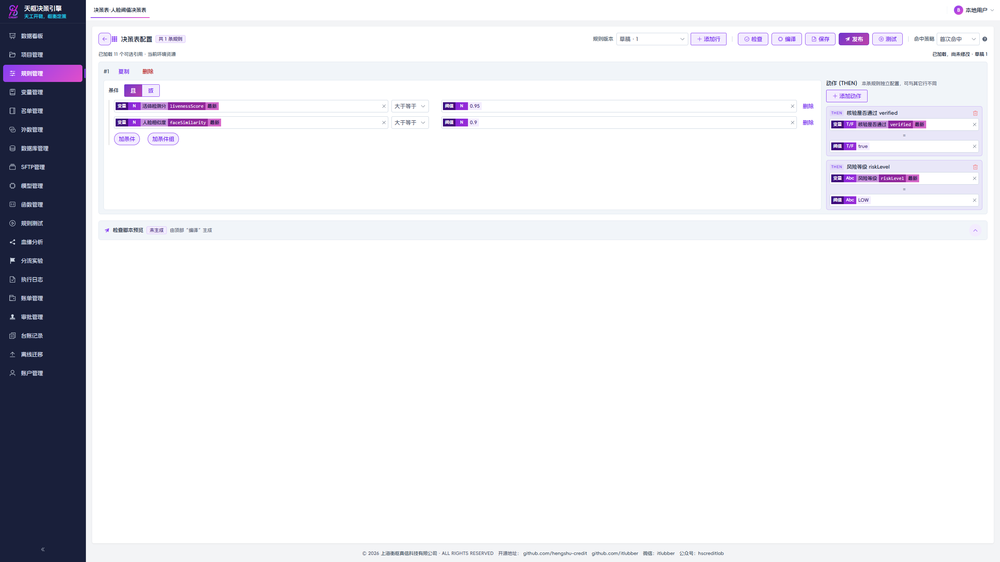
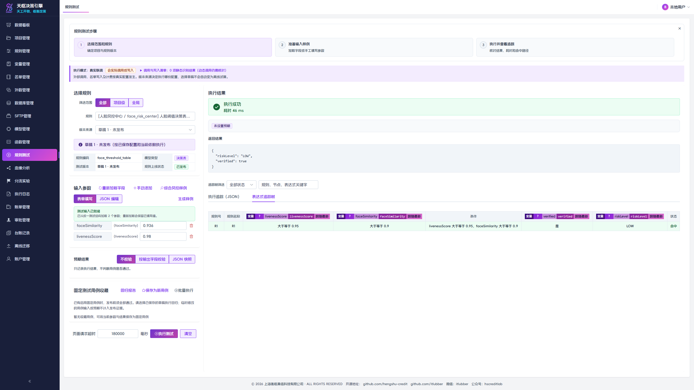

# 两项分数，一次决策：用天枢配置、测试和发布第一条风控规则

一次线上身份核验返回了两个数字：活体检测分是 0.98，人脸相似度是 0.936。这笔申请能否自动通过？如果相似度降到 0.899，谁来复核？等到下个月调整阈值，又怎样解释今天这笔申请为什么通过？

天枢决策引擎把这几件事放进同一个工作流程。策略人员在控制台写下判断条件和处理结果，评审人员用样例核对边界，业务系统调用已发布的规则，运营人员按执行记录回看当时的决定。下面用一张决策表走完这条路径。两个分数都由调用方提供，练习只需填写数字。阈值是教学示例，实际业务需要用自己的核验数据确定。

## 先把业务约定写清楚

假设核验团队约定：活体检测分达到 0.95，**并且**人脸相似度达到 0.90，申请才自动通过。只要有一项低于门槛，就交给人工复核。“恰好等于”算通过。调用方需要知道两件事：能否自动通过，以及下一步按哪个等级处理。

在有编辑权限的练习项目中打开「变量管理」，准备下面四个字段。同项目已有适用字段时可以直接选用。新建字段时设为项目级，输入分数的来源选「输入参数」，保存草稿并按页面流程完成审批，使字段生效。

| 字段编码 | 类型 | 在这条规则里的用途 |
| --- | --- | --- |
| `livenessScore` | 数值 | 输入，活体检测分 |
| `faceSimilarity` | 数值 | 输入，人脸相似度 |
| `verified` | 布尔 | 输出，`true` 表示可以自动通过 |
| `riskLevel` | 字符串 | 输出，`LOW` 表示低风险，`REVIEW` 表示转人工复核 |

这里把“转人工”单独写进返回值。业务系统拿到 `verified = false` 时，还可以根据 `riskLevel = REVIEW` 把申请送进复核队列。

## 在决策表里配置两行

进入「规则管理」，点「新建规则」，选「项目级」和刚才的项目。规则名称可填“人脸核验分流练习”，编码可填 `face_review_demo`，模型类型选「决策表」，再点「创建并继续配置」打开设计器。

在决策表设计器把「命中策略」设为「首次命中」。每一行左边配置条件，右边配置动作。条件和动作目标都从字段选择器选取，右侧用于比较的分数填写数值常量。按下表配好第一行，再点「添加行」配置第二行。

| 行 | 条件组 | 两个赋值动作 |
| --- | --- | --- |
| 1 · 自动通过 | **与（AND）**：`livenessScore ≥ 0.95`，`faceSimilarity ≥ 0.90` | `verified = true`，`riskLevel = "LOW"` |
| 2 · 转人工 | **或（OR）**：`livenessScore < 0.95`，`faceSimilarity < 0.90` | `verified = false`，`riskLevel = "REVIEW"` |

每行用「添加动作」补齐第二个输出。`verified` 的值选择布尔值，`riskLevel` 的值选择字符串。保存草稿并编译，在规则详情核对「输入字段」和「输出字段」。此时可以测试草稿，线上调用仍使用已发布版本。



*图中是仓库演示规则的通过行。练习中增加的第二行专门处理转人工的情况。*

## 用五笔申请检验规则

打开「规则测试」，选择项目、刚保存的规则和对应的草稿版本，在输入表单中填写两个分数，执行测试。先将实际输出与下表对照，再展开「表达式追踪树」查看命中行、比较结果和赋值动作。

| 情形 | 活体检测分 | 人脸相似度 | 预期命中 | 预期输出 |
| --- | ---: | ---: | --- | --- |
| 两项都高于门槛 | 0.98 | 0.936 | 第 1 行 | `true / LOW` |
| 两项恰好压线 | 0.95 | 0.90 | 第 1 行 | `true / LOW` |
| 只有相似度差一点 | 0.95 | 0.899 | 第 2 行 | `false / REVIEW` |
| 只有活体分差一点 | 0.949 | 0.90 | 第 2 行 | `false / REVIEW` |
| 两项都低于门槛 | 0.94 | 0.89 | 第 2 行 | `false / REVIEW` |

第三笔最值得展开看：活体分 0.95 已达到门槛，相似度 0.899 却低于 0.90，因此第一行跳过，第二行赋值为 `false / REVIEW`。如果误把第二行也设成「与」，只有一项低分的申请就会漏掉。只测第一笔或最后一笔，很难发现这个错误。



确认每笔结果符合业务约定后，切到「测试用例」，打开「当前规则用例」并点「保存为新用例」，分别命名，例如“两项恰好压线”和“仅相似度不足”。在已保存的草稿上勾选这些固定用例，点「批量执行」，点「查看回归结果」核对结果。今后修改阈值时，这五笔申请就能重复使用；有启用的固定用例时，发布前须全部通过。

## 发布后，业务系统怎样使用结果？

在规则详情完成发布前校验，核对输入输出、依赖和回归结果，再提交审批。评审人员可以拿“相似度 0.899 应当转人工”这样的具体用例核对策略意图。批准并发布后，在「项目管理」找到该项目，点「API」取得包含本项目鉴权方式、请求字段和响应结构的接口文档。接入方可直接调用服务端 API，也可导出 OpenAPI 3.1 文件，在 Postman 或 Apifox 中联调。

以标准服务端执行接口为例，业务系统按项目文档配置鉴权，向 `POST /api/rule/sync/execute/face_review_demo` 发送第三笔申请的 JSON 请求体：

```json
{
  "clientAppName": "verification-service",
  "params": { "livenessScore": 0.95, "faceSimilarity": 0.899 }
}
```

业务系统先检查响应的 `success`。执行成功后，读取 `data.result` 里的 `verified` 和 `riskLevel`。本次得到 `false / REVIEW`，业务系统据此把申请送进复核队列。

如果有人问“这笔为什么转人工”，在「执行日志」按此次调用的追踪号找到记录，核对执行版本、当时的输入和输出。有表达式追踪的记录还可以展开具体的比较过程。即使阈值后来调过，也能按当时的版本解释这笔决定。

## 当策略超出一张表

| 业务问题 | 天枢里可以怎样配置 |
| --- | --- |
| 判断步骤变多，或出现例外条款 | 用决策树逐层判断；多个分支需要重新汇合时用决策流；多条可独立命中的检查可以放入规则集。 |
| 结果来自矩阵或累计得分 | 用交叉表按行列取结果，用评分卡按项计分；更细的维度分段、矩阵和等级区间可用复杂交叉表、复杂评分卡。需要直接编写表达式时可选 QL 脚本。加上本例的决策表，共有九类设计器。 |
| 调用方只有业务原始数据 | 可以把供应商 API 的响应字段映射为变量，也可以从数据库查询、名单匹配或 PMML、ONNX 模型取得结果。先在相应模块用样例核对取值，再让规则引用；多个策略共用的计算可封装为函数。 |
| 想把相似度门槛从 0.90 调到 0.92 | 先通过血缘分析查看哪些规则引用相关资源，再在新草稿中加入相似度 0.91 的用例。需要比较两版时，可用分流实验配置冠军组、挑战组和流量，结合分流日志核对每笔实际进入的组。 |
| 想知道策略变更后发生了什么 | 在数据看板按项目、规则和时间查看决策分布，到执行日志查单笔原因。涉及付费外数时，可结合调用日志和账单明细核对调用与费用。 |

第一次体验，可以先只做“恰好压线”和“只有一项差一点”两笔。能在追踪树中指出哪项比较改变了结果，就已经掌握了这套工具最常用的操作。项目目前处于未发布阶段，完整控制台操作及系统接入方式见[操作手册](index.html)和 [Java 服务接入指南](java-service-integration.md)。
